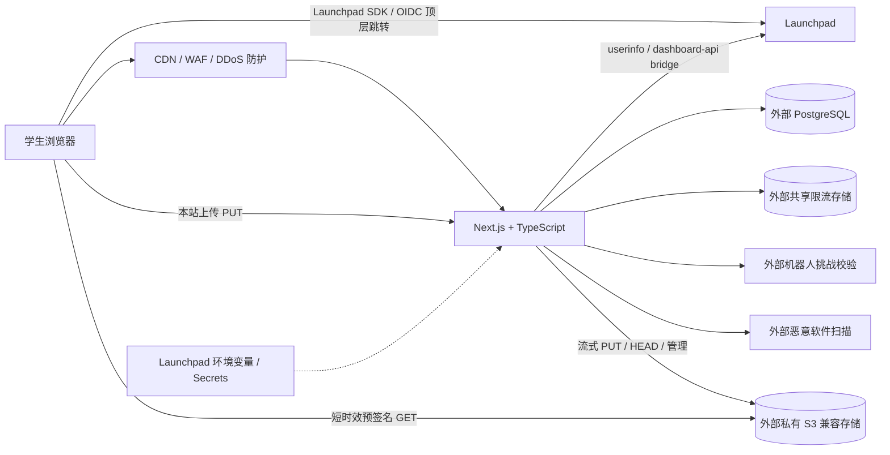

# SHSID Online MVP 产品需求文档

> 文档状态：Draft v0.4（当前实现基线）
> 更新日期：2026-11-01
> 来源：从 `SHSID-Online-PRD.md` Phase 1 提取
> 产品范围：Launchpad 鉴权 + Resource Hub + 最低必要的安全与管理能力
> 技术基线：Launchpad 部署的 Next.js App Router + React + TypeScript strict mode 应用，外接 PostgreSQL、私有 S3 兼容对象存储与其他基础服务

## 1. MVP 定义

SHSID Online MVP 是一个只向通过 Launchpad 验证的 SHSID 学生开放的资源共享平台。学生可以搜索、上传、下载和管理学习资源；管理员可以处理举报、隐藏资源和封禁用户。

MVP 不设置固定学科栏目，以搜索为主要发现方式。当前上传由浏览器发送到本站受保护的上传接口，再由 Next.js 流式写入私有 S3 兼容存储；下载通过短时效预签名 URL 由浏览器直接从对象存储获取。上传内容会经过本站、反向代理和服务器网络，不能描述为浏览器直传对象存储。

### 1.1 已确定决策

- 使用 Launchpad 已识别、已启用 HTTPS 的生产域名。
- 使用 Launchpad 官方同源 SDK 发起 OIDC Authorization Code + PKCE；SDK 在浏览器会话中管理 verifier、`state`、`nonce` 和保留 callback，本站不并行维护第二套 PKCE 事务。
- 浏览器只把 SDK 返回的短时效 Launchpad access token 提交到本站同源会话接口；本站必须通过 `/oauth/userinfo` 重新取得身份并执行准入判断，不信任客户端上报的用户对象。
- 登录成功后签发本站服务端会话，不使用 Launchpad access token 直接作为长期会话。
- 本站会话首选 `HttpOnly + Secure + SameSite=Lax` Cookie。若 Launchpad 代理已确认无法持久化应用 `Set-Cookie`，允许使用受控兼容传输：仅把随机、短时效的本站会话 token 保存到 IndexedDB，由同源 Service Worker 注入专用请求头；不得写入 `localStorage`/`sessionStorage`，不得把 Launchpad token 保存为本站长期会话，并必须在代理恢复 Cookie 能力后移除兼容传输。
- 生产环境显式设置 `SHSID_LAUNCHPAD_OIDC_DEV=0`。
- 文件恶意软件扫描为 P0；扫描未通过时禁止发布。
- 使用边缘 WAF/DDoS 防护、共享应用层限流和风险自适应机器人检查。
- Launchpad 只承载应用计算层；状态数据和文件分别保存在外部 PostgreSQL 和私有 S3 兼容存储中。
- 生产密钥使用 Launchpad 环境变量/Secrets 注入；不将真实 `.env`、凭据或连接串提交到仓库。

## 2. 目标与非目标

### 2.1 MVP 目标

- 只允许符合组织白名单的已验证学生访问业务功能。
- 用户能在 3 分钟内发布一个合规的资源。
- 用户能按标题、描述、标签或文件名找到可用资源。
- 用户只能下载当前仍为 `active` 的资源。
- 任何上传文件在公开前完成校验与恶意软件扫描。
- 管理员能够对资源与用户实施最低必要的治理。
- 滥用或自动化流量不会直接耗尽鉴权、数据库、签名或扫描资源。

### 2.2 明确不做

- Q&A、回答、评论、最佳答案。
- 点赞、收藏、关注、私信、排行榜。
- 实时群聊、阅后即焚、消息推送。
- 固定学科栏目或多级分类导航。
- 复杂推荐算法、在线协作编辑、文件转码。
- 多文件资源包和压缩包上传。

## 3. 用户与权限

| 角色 | 权限 |
|---|---|
| 未登录访客 | 只可查看登录页、隐私说明、服务条款和错误页 |
| 已验证学生 | 搜索、查看、下载、上传资源；编辑/删除自己的资源；举报他人资源 |
| 管理员 | 拥有学生权限；处理举报；隐藏、恢复或下架资源；封禁用户；查看审计记录 |

### 3.1 准入条件

必须同时满足：

- Launchpad `userinfo.sub` 存在；
- `verified === true`；
- `org` 命中服务端 SHSID 白名单；
- 若平台确认需要 capability，`allows` 必须包含对应权限；
- 本站用户状态为 `active`。

任一条件失败时不创建本站会话，且不得仅根据邮箱后缀放行。

## 4. 核心用户流程

### 4.1 登录

1. 用户点击“使用 Launchpad 登录”。
2. 页面从应用 origin 加载 `/dashboard-api/oauth/sdk.js`，调用 `LaunchpadAuth.ready()` 或 `LaunchpadAuth.signIn()`。
3. Launchpad SDK 获取 bootstrap 配置，生成 PKCE verifier/challenge、`state` 和 `nonce`，并将短时登录状态保存在浏览器 `sessionStorage`。
4. 浏览器顶层跳转至 Launchpad authorize 端点；Launchpad 将一次性 code 返回平台保留的 `/__lp_auth/callback`。
5. Launchpad SDK 校验 `state` 和 `nonce`，使用原 verifier 交换一次 code，并在 SDK 状态中提供短时效 access token 和用户资料。
6. 浏览器将 access token 提交到本站同源 `POST /api/auth/launchpad/session`；客户端资料不作为准入依据。
7. 本站服务端使用 access token 调用 `/oauth/userinfo`，执行组织、验证状态、capability 和本站用户状态校验，创建或更新本站用户。
8. 本站服务端创建随机会话，数据库只保存哈希；响应优先设置 `HttpOnly + Secure + SameSite=Lax` Cookie。
9. 若部署平台已确认丢弃应用 `Set-Cookie`，会话接口可同时返回一次本站随机 token 及过期时间；登录页将其写入 IndexedDB，由同源 Service Worker 为受保护请求注入 `x-sider-session`，随后立即清除 Launchpad SDK token。
10. 兼容传输下不得把本站 token 写入 `localStorage`/`sessionStorage`、URL、日志或错误信息；登出必须同时撤销数据库会话并清除 IndexedDB。

### 4.2 上传

1. 用户提交标题、描述、标签、原始文件名、大小和 Content-Type。
2. 服务端执行会话、用户状态、限流、机器人挑战、字段、类型和大小校验。
3. 服务端创建 `pending` 记录、不可预测的 `pending/` object key 和短时效本站上传 URL。
4. 浏览器使用 `PUT` 将单个文件发送到本站上传接口；上传接口重新校验同源、会话、用户状态、限流、资源所有权、意图时效、Content-Length 和 Content-Type。
5. 本站上传接口将请求体以流方式写入私有对象存储，不把完整文件读入应用内存。反向代理必须对该上传路径关闭请求体缓冲，避免先落盘/完整接收后再转发。
6. 浏览器调用幂等 complete 接口。
7. 服务端通过 HEAD 确认对象、大小和类型，然后将状态设为 `scanning`。
8. 扫描通过后进入 `active`；失败、超时或扫描服务不可用时进入 `quarantined`。

### 4.3 下载

1. 用户在资源详情页请求下载。
2. 服务端重新校验会话、用户状态、资源状态、限流与风险信号。
3. 只有 `active` 资源可获得 60–300 秒有效的预签名 GET URL。
4. 浏览器直接从对象存储下载。

## 5. 功能需求

优先级：P0 为 MVP 发布必须，P1 为发布后增强。

### 5.1 鉴权与会话

| ID | 优先级 | 需求 |
|---|---|---|
| MVP-AUTH-01 | P0 | 使用 Launchpad 官方同源 SDK 执行 Authorization Code + PKCE S256；SDK 必须校验 `state` 和 `nonce`，本站不得在保留 callback 上并行实现第二套 PKCE 状态机。 |
| MVP-AUTH-02 | P0 | 生产 OAuth SDK、bootstrap、token 和 userinfo 请求通过已识别 HTTPS 域名下的 `/dashboard-api/` bridge。 |
| MVP-AUTH-03 | P0 | access/id token 不做本地 HS256 验签；身份以服务端调用 `/oauth/userinfo` 的结果为准。 |
| MVP-AUTH-04 | P0 | `sub` 是外部身份唯一键；email 只作为可更新资料。 |
| MVP-AUTH-05 | P0 | 所有业务页、业务 API、上传接口和预签名 URL 接口要求有效本站会话；Launchpad access token 只能用于同源会话交换，不能直接访问业务 API。 |
| MVP-AUTH-06 | P0 | 登出立即撤销服务端会话并清除 Cookie 或兼容传输中的 IndexedDB token；不声称这会撤销 Launchpad 全局会话。 |
| MVP-AUTH-07 | P0 | 不记录 token、会话明文或完整预签名 URL。 |
| MVP-AUTH-08 | P0 | 封禁用户时立即撤销其全部本站会话。 |
| MVP-AUTH-09 | P0 | 在平台确认前，本站会话绝对有效期不超过 1 小时。 |
| MVP-AUTH-10 | P0 | 本站会话首选 HttpOnly Cookie；只有在平台代理确认无法保留 `Set-Cookie` 时才允许 IndexedDB + 同源 Service Worker 请求头兼容传输，并记录启用原因、威胁模型、移除条件和回归测试。 |

### 5.2 搜索与资源发现

| ID | 优先级 | 需求 |
|---|---|---|
| MVP-SEARCH-01 | P0 | `/resources` 不展示固定栏目，搜索框是主入口。 |
| MVP-SEARCH-02 | P0 | 搜索覆盖标题、描述、标签和原始文件名。 |
| MVP-SEARCH-03 | P0 | 只返回 `active` 资源。 |
| MVP-SEARCH-04 | P0 | 非空查询默认按相关性排序；空查询显示最近资源并按发布时间排序。 |
| MVP-SEARCH-05 | P0 | 使用稳定分页/游标，每页默认 20 条，同分结果不重复、不遗漏。 |
| MVP-SEARCH-06 | P0 | 查询去除首尾空格、限制长度并使用参数化查询。 |
| MVP-SEARCH-07 | P1 | 使用 PostgreSQL Full Text Search + `pg_trgm` 增加模糊匹配、高亮和文件类型筛选。 |

### 5.3 上传、扫描与状态

| ID | 优先级 | 需求 |
|---|---|---|
| MVP-UPLOAD-01 | P0 | 单次只上传一个文件；标题 1–120 字符，描述最多 2,000 字符，标签最多 10 个、每个最多 30 字符。 |
| MVP-UPLOAD-02 | P0 | 默认最大 50 MB，通过环境配置调整。 |
| MVP-UPLOAD-03 | P0 | 允许 PDF、DOCX、PPTX、XLSX、TXT、PNG、JPG/JPEG；拒绝可执行文件、脚本、宏文件和压缩包。 |
| MVP-UPLOAD-04 | P0 | 不只信任扩展名或浏览器 Content-Type；必须在服务端/扫描阶段识别真实文件类型。 |
| MVP-UPLOAD-05 | P0 | 使用不可预测 object key；用户文件名仅作为清理后的展示元数据。上传意图返回短时效本站 URL，不得把对象存储写凭据暴露给浏览器。 |
| MVP-UPLOAD-06 | P0 | 本站上传接口必须校验资源所有权、意图时效、声明大小和类型，并以流方式写入 S3；complete 接口幂等，并通过 HEAD 校验对象是否存在、大小和类型是否一致。 |
| MVP-UPLOAD-07 | P0 | 扫描通过前不得进入 `active`；扫描错误、超时或服务不可用时 fail-closed。 |
| MVP-UPLOAD-08 | P0 | 使用应用对账任务与 `pending/` Lifecycle 规则清理孤儿对象；使用 multipart 时自动终止过期分片。 |
| MVP-UPLOAD-09 | P1 | 保存 SHA-256，用于重复提示与安全追踪。 |
| MVP-UPLOAD-10 | P0 | 反向代理对上传路径设置略高于应用上限的 body size，关闭请求体缓冲并配置覆盖最慢允许上传的发送/读取超时；应用和代理限制必须通过 50 MB 边界及并发上传测试。 |

资源状态流转：

```text
pending -> scanning -> active
                    -> quarantined
pending -> failed
active  -> hidden -> active
active/hidden/quarantined -> deleted
```

### 5.4 详情、下载与作者操作

| ID | 优先级 | 需求 |
|---|---|---|
| MVP-RESOURCE-01 | P0 | 详情页显示标题、描述、标签、文件名、类型、大小、上传者显示名和发布时间。 |
| MVP-RESOURCE-02 | P0 | 每次下载签名前重新校验用户和资源状态。 |
| MVP-RESOURCE-03 | P0 | bucket 和对象不得公开；数据库不得保存永久公开 URL。 |
| MVP-RESOURCE-04 | P0 | 只有作者或管理员可编辑元数据或删除资源；不允许静默替换已发布文件。 |
| MVP-RESOURCE-05 | P0 | 删除采用软删除，立即停止签发新下载 URL，对象由后台任务延迟删除。 |
| MVP-RESOURCE-06 | P0 | 对 deleted、hidden、quarantined 和不存在的资源返回统一不可用响应。 |

### 5.5 举报与管理

| ID | 优先级 | 需求 |
|---|---|---|
| MVP-MOD-01 | P0 | 学生可以按“版权/隐私、恶意文件、不当内容、垃圾内容、其他”举报。 |
| MVP-MOD-02 | P0 | 同一用户对同一资源只能有一个未处理举报。 |
| MVP-MOD-03 | P0 | 管理员可查看队列并隐藏、恢复或下架资源。 |
| MVP-MOD-04 | P0 | 管理动作记录操作者、时间、对象、动作和原因。 |
| MVP-MOD-05 | P0 | 被封禁用户不能上传、下载或获得新预签名 URL。 |

### 5.6 限流、DDoS 防护与机器人检查

| ID | 优先级 | 需求 |
|---|---|---|
| MVP-SEC-01 | P0 | 生产流量先经过 CDN/反向代理、WAF 与 DDoS 防护；禁止绕过防护直达 origin。 |
| MVP-SEC-02 | P0 | 按 IP、用户/会话和操作类型组合限流；多实例使用共享原子存储。 |
| MVP-SEC-03 | P0 | 只信任已配置代理写入的客户端 IP，忽略或覆盖公网伪造的转发头。 |
| MVP-SEC-04 | P0 | 鉴权前先执行 IP/总流量粗限流，再进行必要的会话与用户状态查询，鉴权后以用户配额为主执行操作级限流；超额返回 `429` 和 `Retry-After`，不继续执行业务查询、对象存储签名或扫描。 |
| MVP-SEC-05 | P0 | 对本站异常授权发起、高频搜索/下载、批量上传或举报按风险触发机器人挑战；不依据 Launchpad 密码失败次数，不将正常取消授权视为攻击，不要求低风险用户每次挑战。 |
| MVP-SEC-06 | P0 | 挑战 token 在服务端校验有效期、hostname/action 和重放；客户端状态不能作为通过依据。 |
| MVP-SEC-07 | P0 | 挑战具有可访问性备选方式；挑战服务故障时高风险写操作 fail-closed，低风险读操作使用更严格限流。 |
| MVP-SEC-08 | P0 | 阈值可配置且可紧急收紧；监控请求率、WAF 拦截、`429`、挑战触发/通过率并对异常告警。 |

OAuth 防护边界与执行顺序：

- Launchpad 负责登录、密码验证、Authorization Code + PKCE、保留 callback、`state`/`nonce` 校验和认证侧防护；本站负责 access token 会话交换、`userinfo` 准入、本站会话和业务接口，不重复建设密码登录风控。
- `/api/auth/launchpad/start` 仅可作为兼容重定向或弃用入口；正式登录由同源 Launchpad SDK 发起。本站不得在 `/__lp_auth/callback` 上创建与 SDK 并行的服务端 `state`/verifier，因为两套状态机会造成 callback `state mismatch`、重复 code 交换或会话丢失。
- 本站首先对 `POST /api/auth/launchpad/session` 执行宽松 IP 总量限流和必要的风险挑战，再调用 `/oauth/userinfo`。无效、过期或撤销的 access token 不得创建本站会话。
- 会话交换接口只接受同源 JSON 请求和 Launchpad SDK access token；不得接受客户端提交的 `sub`、email、org、verified、allows 或 role 作为身份事实。
- 风险信号使用本站可观测的异常会话交换、无效 access token、重复交换和共享出口峰值；正常取消授权、SDK 初始化失败和平台故障单独统计，不计为恶意密码失败。本站不假设能够获取 Launchpad 密码失败次数。
- 同一校园出口下的集中登录必须以真实 SDK 往返和会话交换路径完成负载测试，不能沿用面向单用户 IP 的低阈值。

初始阈值（OAuth 总量阈值须经集中登录测试后确定，不沿用每 IP 5 次/10 分钟的授权入口或 30 次/10 分钟的回调硬上限）：

| 操作 | 用户/会话 | IP | 机器人检查 |
|---|---:|---:|---|
| Launchpad SDK 授权往返 | 由 SDK 管理单浏览器 PKCE 状态 | 由 Launchpad/边缘侧容量策略保护 | SDK 校验 state、nonce 与 PKCE；callback 不插入本站交互挑战 |
| 本站会话交换 | access token 仅用于一次准入与本站会话创建 | 宽松总量及无效 token 阈值分别配置，按集中登录测试确定 | 异常重复交换按风险挑战；挑战在 userinfo 前完成 |
| 搜索 | 60 次 / 分钟 | 120 次 / 分钟 | 持续满额或异常模式触发 |
| 上传意图 | 10 次 / 小时 | 30 次 / 小时 | 短时批量触发 |
| 上传传输 | 12 次 / 小时 | 40 次 / 小时 | 仅允许匹配本人有效 pending 意图的传输 |
| complete | 20 次 / 小时 | 60 次 / 小时 | 重复请求依赖幂等 |
| 下载链接 | 120 次 / 小时 | 300 次 / 小时 | 异常批量触发 |
| 举报 | 10 次 / 天 | 30 次 / 天 | 异常批量触发 |

阈值是内测起点，必须根据真实流量、学校共享出口 IP 和误拦率调整。

### 5.7 外部服务与环境配置

| ID | 优先级 | 需求 |
|---|---|---|
| MVP-ENV-01 | P0 | Launchpad 只部署 Next.js 计算层；PostgreSQL、S3 兼容存储、共享限流、扫描和机器人挑战作为外部服务连接。 |
| MVP-ENV-02 | P0 | 本地开发只使用未提交的 `.env.local`；生产变量和密钥使用 Launchpad 环境变量/Secrets，不得进入仓库、镜像或构建产物。 |
| MVP-ENV-03 | P0 | 除可公开的 bot site key 外，密钥不得使用 `NEXT_PUBLIC_`，且只能由服务端模块读取。 |
| MVP-ENV-04 | P0 | 应用启动时使用 schema 验证环境变量，缺失、错误或占位值导致启动失败。 |
| MVP-ENV-05 | P0 | PostgreSQL 使用 TLS、最小权限用户和受控连接池；连接上限覆盖计划应用实例但不超过数据库配额。 |
| MVP-ENV-06 | P0 | S3 凭据只能访问指定 bucket/prefix；bucket 保持私有。浏览器只使用短时效预签名 GET 下载；上传写凭据和 PUT 能力只存在服务端。 |
| MVP-ENV-07 | P0 | 所有外部服务使用 TLS；M0 验证出口网络、DNS、防火墙/允许列表、延迟、超时和不可用时的 fail-closed 行为。 |
| MVP-ENV-08 | P0 | 凭据具有所有者、轮换和撤销流程；旧凭据在轮换后不得继续访问生产服务。 |

## 6. 页面与路由

| 路由 | 内容 |
|---|---|
| `/login` | 产品说明、Launchpad 登录、隐私/条款、错误提示 |
| `/resources` | 主搜索框、上传入口、结果/最近资源、分页 |
| `/resources/new` | 单文件选择、元数据、上传/扫描进度、错误恢复 |
| `/resources/[id]` | 资源元数据、下载、举报、作者编辑/删除 |
| `/me/resources` | 当前用户的 pending、scanning、active、hidden、quarantined 和 failed 资源 |
| `/admin/reports` | 举报队列、资源状态、处理动作和原因 |
| `/auth/error` | 授权取消、组织不允许、验证失败、平台不可用 |

移动端优先，最低支持 360 px。主要流程可用键盘完成，表单有可见 label，错误不只依靠颜色传达。

## 7. 技术架构



### 7.1 TypeScript 要求

- 所有应用代码使用 TypeScript，`tsconfig.json` 开启 `strict: true`。
- 禁止未解释的 `any`；外部响应先作为 `unknown` 处理。
- Launchpad `userinfo`、表单、query、API body、环境变量和对象存储回调必须进行运行时 schema 校验。
- Drizzle schema 是数据库类型来源；禁止并行维护一套不受校验的手写数据库类型。
- CI 必须运行 `tsc --noEmit`、lint、单元测试和关键集成测试。

### 7.2 架构原则

- Launchpad 官方 SDK 承担 PKCE、保留 callback 和 code 交换；Next.js Route Handlers 承担 access token 会话交换、`userinfo` 准入、本站会话、业务 API 和管理接口。
- Launchpad 部署单元只承载应用计算层；持久状态、文件、共享限流和扫描等能力由外部服务提供。
- 不使用客户端用户对象作为身份信任边界。
- 用户文件最终只存在私有对象存储中；上传数据可以流经受保护的反向代理和 Next.js，但不得持久化到应用磁盘。上传路径必须关闭代理请求体缓冲。
- 鉴权前先完成 IP/总流量粗限流；粗限流通过后才允许会话与用户状态查询，再执行用户/操作级限流。用户限流或机器人挑战拒绝后不得开始资源业务查询、对象存储签名、对象读取或扫描。
- origin 只信任明确配置的边缘代理链。
- 本地开发只使用未提交的 `.env.local`；生产密钥、数据库连接串和签名凭据通过 Launchpad 环境变量/Secrets 提供，不进入仓库、镜像或构建产物。

### 7.3 环境变量合同

| 分类 | 环境变量 | 要求 |
|---|---|---|
| 应用 | `APP_BASE_URL` | HTTPS 生产 origin |
| 会话 | `SESSION_SECRET`、`SESSION_TOKEN_PEPPER` | 高强度、仅服务端可见、可轮换 |
| PostgreSQL | `DATABASE_URL` | 必须使用 TLS、连接池和最小权限用户 |
| S3 | `S3_ENDPOINT`、`S3_REGION`、`S3_BUCKET`、`S3_ACCESS_KEY_ID`、`S3_SECRET_ACCESS_KEY`、`S3_FORCE_PATH_STYLE` | endpoint 必须为 HTTPS，凭据只能访问指定 bucket/prefix |
| 限流 | `RATE_LIMIT_URL`、`RATE_LIMIT_TOKEN` | 共享原子存储，token 仅服务端可见 |
| 机器人检查 | `NEXT_PUBLIC_BOT_SITE_KEY`、`BOT_VERIFY_URL`、`BOT_VERIFY_SECRET` | 只有 site key 可公开 |
| 恶意软件扫描 | `MALWARE_SCAN_URL`、`MALWARE_SCAN_TOKEN` | 仅服务端可见，配置超时 |
| Launchpad 运行环境 | `SHSID_LAUNCHPAD_OIDC_DEV=0` | 生产强制值 |

规则：

- 仓库只提交不含真实值的 `.env.example`；`.env*` 默认忽略，仅 `.env.example` 例外。
- 启动时使用 schema 验证必需变量，缺失、错误或占位值导致启动失败。
- 不在日志、错误页、前端 bundle、构建输出或监控 metadata 中输出变量值。
- 密钥按服务独立分配并定期轮换；怀疑泄露时立即撤销。

## 8. 数据模型

### `users`

- `id` UUID PK
- `launchpad_sub` text unique
- `email`、`display_name`、`avatar_url`、`org`、`verified`
- `role`: `student | admin`
- `status`: `active | suspended`
- `created_at`、`updated_at`、`last_login_at`

### `sessions`

- `id` UUID PK
- `user_id` FK
- `token_hash` text unique
- `expires_at`、`created_at`、`last_seen_at`、`revoked_at`

### `resources`

- `id` UUID PK、`author_id` FK
- `title`、`description`、`tags[]`
- `original_filename`、`object_key`
- `mime_type`、`size_bytes`、`sha256` nullable
- `status`: `pending | scanning | active | hidden | quarantined | deleted | failed`
- `moderation_reason` nullable
- `created_at`、`updated_at`、`published_at`、`deleted_at`
- 搜索向量及 GIN/GiST 索引

### `resource_reports`

- `id`、`resource_id`、`reporter_id`
- `reason`、`details`
- `status`: `open | resolved | dismissed`
- `handled_by`、`handled_at`、`resolution_note`、`created_at`
- 同一 reporter/resource 的未处理举报唯一约束

### `audit_logs`

- `id`、`actor_id`、`action`、`target_type`、`target_id`、`metadata`、`created_at`
- `metadata` 不得包含 token、会话明文、挑战 token 或预签名 URL

## 9. API 边界

| 方法与路径 | 用途 |
|---|---|
| `GET /api/auth/launchpad/start` | 兼容入口；重定向登录页并由 Launchpad SDK 发起授权，不生成本站 PKCE 状态 |
| `GET /__lp_auth/callback` | Launchpad SDK 保留 callback；页面加载后由 SDK 校验 state/nonce 并交换 code |
| `POST /api/auth/launchpad/session` | 接收 SDK access token、调用 userinfo、执行准入并创建本站会话 |
| `POST /api/auth/logout` | 撤销本站会话 |
| `GET /api/me` | 返回最小当前用户资料 |
| `GET /api/resources?q=&cursor=&sort=` | 搜索或最近资源 |
| `POST /api/resources/upload-intents` | 创建 pending 记录和短时效本站上传 URL |
| `PUT /api/resources/:id/upload` | 校验上传意图并将请求体流式写入私有对象存储 |
| `POST /api/resources/:id/complete` | 幂等校验对象并开始扫描 |
| `GET /api/resources/:id` | 资源详情 |
| `PATCH /api/resources/:id` | 作者/管理员编辑元数据 |
| `DELETE /api/resources/:id` | 软删除资源 |
| `POST /api/resources/:id/download` | 校验后签发预签名 GET URL |
| `POST /api/resources/:id/reports` | 举报资源 |
| `GET /api/admin/reports` | 管理员查看举报 |
| `POST /api/admin/resources/:id/moderate` | 隐藏、恢复或下架 |

所有变更接口实施 CSRF/严格同源防护、服务端鉴权、资源级授权、运行时 schema 校验与分层限流。机器人挑战 token 随原请求提交并同步校验，不设置可被重放的独立“验证成功”接口。

## 10. 非功能需求

### 10.1 安全与隐私

- 生产全站 HTTPS；Cookie 使用 `HttpOnly + Secure + SameSite=Lax`。兼容会话传输只允许随机本站 token 存入 IndexedDB，并由固定路径、同源、版本化 Service Worker 注入专用头；任何同源脚本可读取 IndexedDB 的剩余风险必须进入威胁模型和 CSP/XSS 验收。
- 不公开 bucket、对象或 origin；不在日志中保存敏感凭据。
- 用户文本按纯文本输出并转义，MVP 资源描述不支持任意 HTML。
- 采用数据最小化，挑战服务不用于跨站广告跟踪。
- 制定隐私说明、可接受使用规则、举报处理规则和数据删除策略。

### 10.2 性能与可靠性

- 常规页面 P95 服务端响应 ≤ 1 秒（不含文件传输）。
- 搜索接口 P95 ≤ 800 ms。
- complete 和后台任务幂等；上传中断可重试。
- 上传路径不在应用内存中缓冲完整文件；反向代理关闭请求体缓冲。50 MB 边界上传和约定并发下，不得因代理临时文件、应用连接、服务器带宽或 120 秒客户端超时产生不可接受失败率。
- PostgreSQL 定期备份并验证恢复；migration 可回滚或有明确前向修复。
- Launchpad、挑战或扫描服务不可用时不错误放行。
- 过期 pending 对象由应用对账与 Lifecycle 双层清理。

### 10.3 兼容性与可访问性

- 支持当前及前一个主要版本的 Chrome、Safari 和 Edge。
- 支持手机和桌面布局。
- 主要流程满足 WCAG 2.1 AA 基础要求。
- 机器人检查必须有键盘可用、非纯视觉的替代方式。

## 11. 成功指标

| 指标 | MVP 目标 |
|---|---:|
| 登录成功率 | ≥ 98%（排除用户主动取消） |
| 上传成功率 | ≥ 95% |
| 搜索结果 API P95 | ≤ 800 ms |
| 下载链接签发成功率 | ≥ 99% |
| 正常已鉴权用户误限流率 | < 1% |
| 机器人挑战完成率 | ≥ 90%（排除明确自动化流量） |
| 搜索无结果率 | 持续记录，首月后制定优化目标 |

同时记录搜索结果点击率、搜索后下载率、查询改写率、扫描失败/超时率、WAF 拦截量、`429` 比例和挑战通过率。

## 12. MVP 验收标准

### 12.1 鉴权

- 合法 SHSID 用户能够在 HTTPS 生产域名完成登录。
- Launchpad SDK 对 `state` 不匹配、nonce 不匹配和 code 重用/过期拒绝登录；本站对 userinfo 401、`verified=false`、org 不允许或 capability 缺失拒绝创建会话。
- `Secure` 本站 Cookie 能够正常写入和回传；若平台代理确认无法保留 `Set-Cookie`，兼容传输能够在不使用 `localStorage`/`sessionStorage` 的前提下完成登录，且退出后 Cookie、IndexedDB token 和旧数据库会话均不可用。
- 客户端伪造 user/sub/org/verified/allows 不能绕过服务端 `/oauth/userinfo` 准入；Launchpad access token 不能直接访问业务 API。
- 生产环境 `SHSID_LAUNCHPAD_OIDC_DEV=0`，未知 origin 不能用 `devOrigin` 绕过。
- 任何日志不包含 token 或会话明文。

### 12.2 资源

- 搜索只返回 active 资源，分页不重复、不遗漏。
- 上传、HEAD 校验、扫描、激活和下载流程可端到端完成。
- 浏览器上传地址指向受保护的本站接口；上传接口拒绝过期意图、非作者、大小/类型不匹配和缺少 Content-Length 的请求，并以流方式写入 S3。
- 反向代理对上传路径关闭请求体缓冲；使用接近 50 MB 的允许文件验证上传期间不会先完整落盘/完整接收后再转发，代理和应用上限边界一致。
- pending/scanning/quarantined/hidden/deleted 资源不可被搜索或下载。
- 超大、不允许、伪造 complete 与越权请求被拒绝。
- 删除或隐藏后不再签发新下载 URL。
- 孤儿对象在设定 TTL 后被对账或 Lifecycle 清理。

### 12.3 安全与滥用防护

- 公网流量不能绕过边缘/WAF 直达 origin。
- 伪造转发 IP 头不能改变限流身份。
- 多实例下限流计数一致，无法通过切换实例规避。
- 超额请求返回 `429` 和 `Retry-After`，且不执行高成本下游操作。
- 粗限流拒绝时不查询应用数据库；实现不得通过 `Promise.all` 并行启动粗限流与会话查询。用户级限流允许此前必要的会话与用户状态查询，拒绝后不得启动资源查询、签名、对象读取或扫描。
- 上线前记录预计同一校园出口的集中登录人数与峰值，在该负载及约定余量下完成授权入口和 callback 测试；正常用户不得因共享 IP 被本站误拦。OAuth 阈值配置及测试结果作为发布验收证据。
- Launchpad SDK 的异常重复发起、无效 state/nonce 和重复 callback 能被识别；本站会话交换具备独立总量保护，重复或无效 access token 不创建多个有效会话。
- 已登录 Launchpad 的 SDK 授权往返也通过上述测试；正常取消授权、SDK 初始化失败、平台故障与无效 token 分类统计，callback 不出现本站交互挑战。
- 伪造、过期、错误 action/hostname 或重放的挑战 token 无法绕过检查。
- 学校共享出口 IP 不会因单一用户行为被长时间整体封禁。
- 压力/滥用演练可观测拦截、`429`、挑战和告警指标。

### 12.4 管理

- 学生可举报，但不能访问管理接口。
- 管理员可处理举报、隐藏/恢复/下架资源并填写原因。
- 管理动作可审计且不包含敏感凭据。
- 封禁用户的既有会话立即撤销。

### 12.5 外部服务与配置

- Launchpad 应用重启、重新部署或回滚后，外部 PostgreSQL 数据和 S3 对象不丢失。
- 缺失/错误环境变量或占位值导致应用拒绝启动，错误信息不显示密钥值。
- 仓库、前端 bundle、镜像、构建日志和错误监控中不包含真实生产凭据。
- 所有外部连接使用 TLS，超时和不可用时的行为符合 fail-closed/降级要求。
- 计划实例数下的数据库连接池总量不超过数据库配额。
- S3 CORS 拒绝非允许 origin/方法/头部，凭据无法访问范围外的 bucket/prefix。
- 凭据轮换演练中新凭据可用，旧凭据已撤销。

## 13. 交付里程碑

| 里程碑 | 交付 | 完成门槛 |
|---|---|---|
| M0 技术验证 | Launchpad SDK 鉴权、本站会话 Cookie/兼容传输、外部 PostgreSQL、应用中转上传、S3 预签名下载、扫描、WAF、共享限流、机器人挑战、Secrets 注入/轮换 | 所有 M0 阻断项已确认，端到端 spike 通过 |
| M1 身份与工程骨架 | TypeScript strict、schema/migration、登录/登出、会话、受保护路由 | 鉴权与类型检查通过 |
| M2 Resource Hub | 上传、扫描、搜索、详情、下载、我的资源 | 核心资源流程端到端通过 |
| M3 安全与管理 | 举报、审核、封禁、限流、挑战、审计、清理 | 安全用例与压力/滥用演练通过 |
| M4 学生内测 | 监控、备份、隐私/规则、兼容性、小范围放量 | 无阻断缺陷，完成恢复和回滚演练 |

## 14. M0 阻断项

1. Launchpad 维护者确认 SHSID `org` 精确值、`verified` 含义与是否需要专属 `allows` capability。
2. 确认本站会话能否长于 Launchpad 约 1 小时 token，以及允许时的绝对/空闲有效期。
3. 明确生产 HTTPS 域名、证书、`/dashboard-api/` bridge、SDK 保留 callback 和续期/健康检查责任人。
4. 在目标 Launchpad 部署验证应用 `Set-Cookie` 是否能够持久化；若不能，书面接受 IndexedDB + Service Worker 兼容传输的威胁模型、CSP/XSS 控制、监控和移除条件。
5. 明确边缘 DDoS/WAF、origin 隔离、共享限流存储与机器人挑战服务及运维责任。
6. 确认机器人挑战的数据处理、隐私和可访问性符合学校要求。
7. 确认恶意软件扫描方案、超时、隔离、重试和告警策略。
8. 确认外部 PostgreSQL、S3、限流、扫描和挑战服务的提供方、运维责任、费用与数据存放区域。
9. 在 Launchpad 生产环境验证出口网络、DNS、防火墙/允许列表、TLS、延迟和超时行为。
10. 明确 Launchpad Secrets 的配置权限，以及所有外部凭据的轮换、撤销和泄露响应流程。
11. 对应用中转上传完成代理请求缓冲检查、50 MB 边界测试、并发测试、超时测试和服务器到对象存储的容量评估；若不能满足目标，恢复预签名 PUT 直传设计。

M0 任一项未完成时，不得开放学生内测。

## 15. 剩余产品决策

下列项不影响技术骨架开始，但必须在相关功能验收前确定：

1. 最终文件类型白名单和大小上限。
2. 管理员名单和举报响应时限。
3. 软删除对象的恢复窗口和物理删除时间。
4. 界面语言：英文、中文或中英双语。
5. 上传者展示实名还是自选昵称。
6. 正式 Launchpad 环境恢复可靠 `Set-Cookie` 后，移除兼容会话传输的目标版本与日期。
7. 应用中转上传是否保留为正式架构；若保留，确定最大并发和带宽容量，若不保留，确定恢复预签名 PUT 的里程碑。

## 16. 参考资料

- 完整路线图：`SHSID-Online-PRD.md`
- Launchpad：<https://launchpad.standardcas.org/>
- Sign in with Launchpad：<https://launchpad.standardcas.org/manual/sign-in-with-launchpad>
- Launchpad Domains：<https://launchpad.standardcas.org/manual/domains>
- SHSID Learn 参考实现：<https://study.standardcas.org/>
- OWASP File Upload Cheat Sheet：<https://cheatsheetseries.owasp.org/cheatsheets/File_Upload_Cheat_Sheet.html>
- Amazon S3 Lifecycle configuration：<https://docs.aws.amazon.com/AmazonS3/latest/userguide/intro-lifecycle-rules.html>
