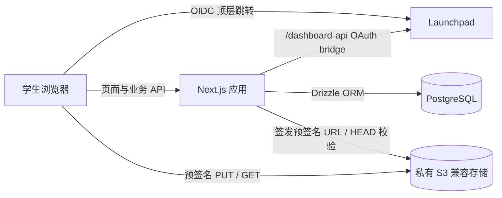

# SHSID Online 产品需求文档（PRD）

> 文档状态：Draft v0.1  
> 更新日期：2026-10-26  
> 第一阶段：Resource Hub + Launchpad 登录/鉴权  
> 技术基线：Next.js、React、PostgreSQL、Drizzle ORM、S3 兼容对象存储

## 1. 项目概述

SHSID Online 是一个仅面向 SHSID 学生的校内 C2C 社区。学生可以分享学习资源、提问与回答，并在后续版本中通过类似 Twitter/X 或 Snapchat 群聊的方式进行即时交流。

产品分阶段建设。第一阶段只交付可上线验证的 MVP：

1. 使用 Launchpad 完成学生身份登录和访问控制；
2. 建立无栏目（无 section）的 Resource Hub；
3. 允许登录用户搜索、上传、下载和管理自己的资源；
4. 提供维持学生社区安全所需的最低限度审核与风控能力。

Q&A 和实时 Communication 在后续阶段实现，不进入第一阶段的开发范围。

## 2. 背景与问题

学生资源目前可能散落在聊天群、个人网盘和不同平台中，存在以下问题：

- 资料难以发现，历史内容容易被新消息淹没；
- 缺少统一的学生身份认证，难以限制社区访问范围；
- 上传者和下载者之间缺少可信、可追溯的关系；
- 现有分类体系容易过时，用户常常不知道资料应该放在哪个栏目。

因此，Resource Hub 不设置固定栏目，而以统一搜索框作为主要入口。资源标题、描述、标签、文件名和上传者信息共同参与检索；标签仅作为搜索元数据，不形成独立栏目或强制分类树。

## 3. 产品目标与成功指标

### 3.1 MVP 目标

- 仅允许通过 Launchpad 验证且属于允许组织的用户进入网站；
- 用户能够在 3 分钟内完成一次资源发布；
- 用户能够通过关键词找到相关资源并安全下载；
- 文件流量不经过 Next.js 应用服务器，上传和下载均使用短时效预签名 URL；
- 管理员能够隐藏违规资源、处理举报，并保留必要的审计信息。

### 3.2 建议的上线后指标

| 指标 | MVP 建议目标 |
|---|---:|
| 登录成功率 | ≥ 98%（排除用户主动取消授权） |
| 上传成功率 | ≥ 95% |
| 搜索结果接口 P95 | ≤ 800 ms |
| 资源下载链接签发成功率 | ≥ 99% |
| 首月有效资源数 | 由产品负责人设定基线后衡量 |
| 搜索无结果率 | 持续记录，首月后制定优化目标 |

“有效资源”指状态为可见、文件可下载且未被判定为重复或违规的资源。

## 4. 用户与权限

### 4.1 用户角色

| 角色 | 权限 |
|---|---|
| 未登录访客 | 仅查看登录页、隐私说明、服务条款和错误页；不能搜索或下载资源 |
| 已验证学生 | 搜索、查看、下载、上传资源；编辑或删除自己发布的资源；举报他人资源 |
| 管理员 | 拥有学生权限；查看举报；隐藏、恢复或下架资源；封禁用户；查看审计记录 |

### 4.2 身份准入规则

MVP 默认采用封闭社区策略：

- Launchpad `userinfo` 返回 `verified: true`；
- `org` 必须匹配服务端配置的 SHSID 组织白名单；
- 本站用户状态必须为 `active`；
- 以上规则不满足时，拒绝创建本站会话并展示明确但不过度泄露信息的错误说明。

`org` 的实际值及是否需要额外的 `allows` capability，必须在联调环境中由 Launchpad 维护者确认。禁止仅依据邮箱后缀完成鉴权。

## 5. 分阶段范围

### Phase 1：MVP

包含：

- Launchpad OIDC 登录、登出、会话管理和访问控制；
- 首次登录时自动创建本站用户；
- Resource Hub 搜索与结果列表；
- 资源详情、上传、下载、编辑和删除；
- “我的资源”；
- 基础举报、管理员隐藏资源和用户封禁；
- 基础日志、错误监控和核心事件统计。

不包含：

- Q&A、评论、点赞、收藏、关注、私信；
- 实时群聊、阅后即焚、消息推送；
- 复杂推荐算法、积分或排行榜；
- 固定学科栏目和多级分类导航；
- 多文件资源包、在线协作编辑、文件在线转码。

### Phase 2：Q&A

- 发布问题、回答、评论和最佳答案；
- 标签和搜索复用 Resource Hub 的检索能力；
- 举报、审核、通知和内容状态管理；
- 资源与问答之间可相互引用。

### Phase 3：Communication

- 创建和加入群聊；
- 实时文本、图片和资源卡片消息；
- 未读状态、提及、成员和群权限；
- 消息保留时间与“类似 Snapchat”的临时消息策略；
- WebSocket/SSE、离线重连、消息顺序和滥用防护。

Phase 3 开始前必须明确：群聊是公开还是邀请制、消息是否自动消失、截屏/转发规则、内容留存与校方合规要求。

## 6. MVP 核心用户故事

### 6.1 登录

- 作为 SHSID 学生，我希望用 Launchpad 登录，不需要新建一套账号密码。
- 作为未获准用户，我希望知道为什么不能进入，以及可以向谁求助。
- 作为用户，我希望退出本站后，本地会话立即失效。

### 6.2 搜索和发现资源

- 作为学生，我希望进入 Resource Hub 后立即看到居中的搜索框。
- 作为学生，我希望输入课程名、主题、文件名或关键词后获得相关结果。
- 作为学生，我希望看到资源标题、简述、文件类型、大小、上传者和发布时间。
- 作为学生，我希望在没有结果时得到修改关键词或上传资源的引导。

### 6.3 发布和管理资源

- 作为学生，我希望上传一个受支持的文件并填写标题、描述和可选标签。
- 作为上传者，我希望修改资源的标题、描述和标签，但不能静默替换已经发布的文件。
- 作为上传者，我希望删除自己的资源；删除后其他用户无法继续获得新的下载链接。
- 作为管理员，我希望隐藏违规或有风险的资源，并记录操作原因。

## 7. 功能需求

需求优先级定义：P0 为 MVP 上线必需，P1 为 MVP 上线后尽快补齐，P2 为后续增强。

### 7.1 Launchpad 登录与本站会话

| ID | 优先级 | 需求 |
|---|---|---|
| AUTH-01 | P0 | 登录采用 OIDC Authorization Code + PKCE（S256）流程，并校验 `state`；建议同时使用 `nonce`。 |
| AUTH-02 | P0 | 生产环境通过应用自身域名下的 `/dashboard-api/` bridge 访问 Launchpad OAuth 端点。 |
| AUTH-03 | P0 | 回调收到 code 后必须立即且仅交换一次；失败时提供可重试的错误页。 |
| AUTH-04 | P0 | access token 不做本地 HS256 验签，身份以 Launchpad `/oauth/userinfo` 返回结果为准。 |
| AUTH-05 | P0 | 使用 Launchpad `sub` 作为外部身份唯一键；email 只能作为资料字段，不作为主键。 |
| AUTH-06 | P0 | 登录成功后签发本站随机会话标识，并通过 `HttpOnly + Secure + SameSite=Lax` Cookie 保存。数据库仅保存会话标识哈希。 |
| AUTH-07 | P0 | 全站业务路由、资源元数据接口和预签名 URL 接口均要求有效本站会话。 |
| AUTH-08 | P0 | 登出使本站会话服务端失效并清除 Cookie；同时说明 Launchpad SDK 的本地登出不等于撤销 Launchpad 全局会话。 |
| AUTH-09 | P0 | 保存最近登录时间；不将 Launchpad access token、id token 写入日志。 |
| AUTH-10 | P1 | 支持管理员强制终止某用户的全部本站会话。 |

推荐由 Next.js Route Handlers 完成 PKCE 回调、`userinfo` 校验和本站会话签发。若采用浏览器 drop-in SDK，必须补充“如何把浏览器身份安全地转换为服务端会话”的设计，禁止仅凭客户端上报的用户对象创建账号。

### 7.2 Resource Hub 首页与搜索

| ID | 优先级 | 需求 |
|---|---|---|
| SEARCH-01 | P0 | Resource Hub 不展示固定栏目；搜索框是页面主入口。 |
| SEARCH-02 | P0 | 搜索覆盖标题、描述、标签和原始文件名。 |
| SEARCH-03 | P0 | 空查询可显示最近发布的有效资源，但不能被呈现为栏目。 |
| SEARCH-04 | P0 | 结果只包含状态为 `active` 的资源。 |
| SEARCH-05 | P0 | 支持按相关性和最新发布时间排序，默认按相关性；空查询默认按最新排序。 |
| SEARCH-06 | P0 | 搜索结果分页或游标加载，每次默认 20 条。 |
| SEARCH-07 | P0 | 搜索词去除首尾空格并限制长度；必须使用参数化查询。 |
| SEARCH-08 | P1 | 支持拼写模糊匹配、高亮命中词和文件类型筛选。 |

MVP 建议先使用 PostgreSQL Full Text Search 配合 `pg_trgm`，避免过早引入独立搜索服务。英文课程名和文件名可用加权全文索引；中英文混合、缩写和模糊匹配由 trigram 补充。排名建议为：标题 > 标签 > 文件名 > 描述。

### 7.3 资源上传

| ID | 优先级 | 需求 |
|---|---|---|
| UPLOAD-01 | P0 | 用户填写标题、描述、可选标签并选择单个文件。 |
| UPLOAD-02 | P0 | 标题 1–120 字符；描述最多 2,000 字符；标签最多 10 个、每个最多 30 字符。 |
| UPLOAD-03 | P0 | MVP 单文件最大 50 MB，该值必须可通过环境配置调整。 |
| UPLOAD-04 | P0 | 默认允许 PDF、DOCX、PPTX、XLSX、TXT、PNG、JPG/JPEG；拒绝可执行文件、脚本、宏文件和压缩包。 |
| UPLOAD-05 | P0 | 服务端创建 `pending` 记录和不可预测的 object key，再签发短时效预签名 PUT URL。 |
| UPLOAD-06 | P0 | 浏览器直接上传至私有 S3 bucket，文件内容不经过 Next.js 服务。 |
| UPLOAD-07 | P0 | 上传完成后调用 complete 接口；服务端通过对象存储 HEAD 检查对象是否存在、大小是否一致、Content-Type 是否允许。 |
| UPLOAD-08 | P0 | 校验通过后资源才可进入 `active`；失败或超时保持不可见并可被定时清理。 |
| UPLOAD-09 | P0 | object key 与用户提交的原始文件名分离；原始文件名仅作为经过清理的展示元数据。 |
| UPLOAD-10 | P0 | 防止重复提交 complete；整个完成操作必须幂等。 |
| UPLOAD-11 | P1 | 文件进入 `scanning` 状态，经恶意软件扫描通过后再发布；扫描失败或超时进入隔离状态。 |
| UPLOAD-12 | P1 | 计算并保存 SHA-256，用于重复文件提示和安全追踪。 |

公开测试前建议将恶意软件扫描提升为 P0。若 MVP 内测阶段暂未实现扫描，应严格限制文件类型、大小和参与用户，并在页面明确提示下载风险。

### 7.4 资源详情与下载

| ID | 优先级 | 需求 |
|---|---|---|
| RESOURCE-01 | P0 | 详情页显示标题、描述、标签、文件名、类型、大小、上传者显示名和发布时间。 |
| RESOURCE-02 | P0 | 下载前由服务端重新校验登录状态、用户状态和资源状态。 |
| RESOURCE-03 | P0 | 校验通过后签发 60–300 秒有效的预签名 GET URL，并设置下载文件名。 |
| RESOURCE-04 | P0 | S3 bucket 和对象不得公开读取；数据库中不得保存永久公开 URL。 |
| RESOURCE-05 | P0 | 只有作者或管理员可以编辑元数据；只有作者或管理员可以删除资源。 |
| RESOURCE-06 | P0 | 删除采用数据库软删除并立即停止签发新下载链接；对象文件由后台任务延迟删除。 |
| RESOURCE-07 | P0 | 对已删除、隐藏、隔离或不存在的资源返回统一的不可用页面，避免泄露审核细节。 |
| RESOURCE-08 | P1 | 记录聚合下载次数；日志不得长期保存完整预签名 URL。 |

### 7.5 举报和基础管理

| ID | 优先级 | 需求 |
|---|---|---|
| MOD-01 | P0 | 登录用户可按“版权/隐私、恶意文件、不当内容、垃圾内容、其他”举报资源。 |
| MOD-02 | P0 | 同一用户对同一资源只能存在一个未处理举报。 |
| MOD-03 | P0 | 管理员可查看待处理举报并隐藏、恢复或下架资源。 |
| MOD-04 | P0 | 管理操作必须记录操作者、时间、对象、动作和原因。 |
| MOD-05 | P0 | 被封禁用户不能上传、下载或获得新的预签名 URL。 |
| MOD-06 | P1 | 达到风险阈值时自动临时隐藏资源，等待人工复核。 |

## 8. 关键业务流程

### 8.1 登录流程

1. 用户点击“使用 Launchpad 登录”。
2. 本站从自身 origin 调用 `/dashboard-api/oauth/bootstrap`，获取与 origin 绑定的 `client_id` 和 redirect URI。
3. 本站生成 PKCE verifier/challenge、`state` 和 `nonce`，将必要的临时状态放入短时效、签名或加密的安全 Cookie。
4. 浏览器顶层跳转至 Launchpad `/oauth/authorize`。
5. 用户在 Launchpad 登录并同意授权；同意页每次都会出现。
6. Launchpad 将一次性 code 返回 `/__lp_auth/callback`。
7. 本站校验 `state`，使用原 verifier 换取 token，并调用 `/oauth/userinfo`。
8. 本站校验 `sub`、`verified`、`org` 和用户封禁状态，创建或更新用户。
9. 本站签发 HttpOnly 会话 Cookie，并跳转回登录前页面或 Resource Hub。

### 8.2 上传流程

1. 客户端提交文件名、大小、Content-Type 和资源元数据。
2. 服务端校验权限、频率、字段、文件类型和大小。
3. 服务端创建 `pending` 资源，生成 object key 和预签名 PUT URL。
4. 客户端直传对象存储，并显示真实进度。
5. 客户端调用 complete 接口。
6. 服务端 HEAD 校验对象；通过后进入扫描或直接激活。
7. 页面跳转到资源详情；失败时保留可重试状态。

### 8.3 下载流程

1. 用户在资源详情点击下载。
2. 服务端校验用户、资源状态和下载限流。
3. 服务端生成短时效预签名 GET URL。
4. 客户端直接从对象存储下载。

## 9. 页面与信息架构

| 页面 | MVP 主要内容 |
|---|---|
| `/login` | 产品说明、Launchpad 登录按钮、隐私/条款入口、登录错误提示 |
| `/resources` | 主搜索框、上传入口、搜索结果或最近资源、分页/加载更多 |
| `/resources/new` | 文件选择、标题、描述、标签、上传进度和错误恢复 |
| `/resources/[id]` | 资源元数据、下载、举报；作者可编辑/删除 |
| `/me/resources` | 当前用户上传的 active、pending、hidden 和 failed 资源 |
| `/admin/reports` | 举报队列、资源状态、处理动作和原因 |
| `/auth/error` | 授权取消、组织不允许、验证失败、平台不可用等可操作错误提示 |

移动端优先，最低支持 360 px 宽度。搜索和下载应可仅使用键盘完成，主要表单字段包含可见 label，错误信息不能只依靠颜色传达。

## 10. 技术架构

### 10.1 技术原则

- Next.js 同时承担前端渲染、业务 API、OAuth 回调和后台管理接口；
- PostgreSQL 存储用户、会话、资源元数据、举报和审计记录；
- 使用 Drizzle ORM 管理 schema 和 migration（原始需求中的 “prizzle” 按 Drizzle 理解）；
- 文件只存储在 S3 兼容对象存储中，bucket 默认为 private；
- 服务端掌握 S3 凭据，仅向已鉴权用户签发单次用途、短时效 URL；
- 定时任务清理过期 `pending` 记录、孤儿对象和软删除对象；
- 所有服务端密钥和连接串通过部署环境变量提供，不进入仓库。

## 11. Launchpad 部署与鉴权结论

### 11.1 明确结论

按照所提供的《Sign in with Launchpad》说明，MVP 最稳妥的方案是：**将 Next.js 应用部署为 Launchpad 已知站点，或至少把生产域名绑定为 Launchpad 已知应用域名。**

不能把任意自托管域名直接当作普通公开 OAuth 客户端使用，原因是：

- `/oauth/bootstrap` 根据受信任反向代理写入的 `X-Forwarded-Host` 识别应用 origin；
- 只有“已部署站点或已绑定域名”能够注册，未知 origin 会返回 `403 origin is not a known Launchpad app`；
- 生产环境不接受客户端在请求体中随意声明 origin；`devOrigin` 只用于启用了开发模式的本地开发；
- SDK 和 OAuth 请求依赖应用自身域名下的 `/dashboard-api/` bridge。

### 11.2 可选部署方案

| 方案 | 可行性 | 建议 |
|---|---|---|
| A. Next.js 直接部署到 Launchpad | 已由说明文档完整支持 | MVP 首选；接入成本和鉴权风险最低 |
| B. 使用 Launchpad 绑定的自定义域名，应用仍由 Launchpad 站点/代理承载 | 已支持，但需确保 nginx vhost 含 `/dashboard-api/` bridge | 可用于正式品牌域名 |
| C. 计算服务完全自托管，但生产域名由 Launchpad 识别并正确反向代理 OAuth bridge | 条件性可行，需要 Launchpad 维护者配置和确认 | 只有在算力、网络或部署限制要求自托管时采用 |
| D. 任意外部域名直接调用 Launchpad OAuth API | 按当前说明不可行 | 不应作为 MVP 方案 |

方案 C 不是“直接调用公开 API”：生产 origin 仍必须被 Launchpad 识别，且前置代理必须可靠地将 `/dashboard-api/` 转发到 Launchpad host-server，并设置可信的 `X-Forwarded-Host`。不得允许公网客户端自行注入该请求头。

PostgreSQL 和 S3 对象存储可以独立部署；上述限制主要针对应用 origin、OAuth bootstrap 和 bridge，不要求数据库与文件存储和 Launchpad 位于同一服务进程。

### 11.3 上线前必须完成的 Launchpad 验证

- 确认生产域名能成功调用 `/dashboard-api/oauth/bootstrap`；
- 确认 `client_id`、redirect URI 和 `/__lp_auth/callback` 一致；
- 确认 `/dashboard-api/oauth/token` 与 `/oauth/userinfo` 可用；
- 确认 `org` 的实际 SHSID 值和 `verified` 的业务含义；
- 确认是否需要为本应用申请专属 `allows` capability；
- 确认本站会话是否可长于 Launchpad 约 1 小时的 access token 生命周期；
- 在自定义域名上遇到 `/dashboard-api/*` 404 时重新 provision vhost；
- 使用 Launchpad 提供的 `lp oidc <id>` 检查 deployed、integrated 和 registered 状态。

## 12. 建议数据模型

### `users`

- `id` UUID，主键
- `launchpad_sub` text，唯一、不可变
- `email` text
- `display_name` text
- `avatar_url` text，可空
- `org` text
- `verified` boolean
- `role` enum: `student | admin`
- `status` enum: `active | suspended`
- `created_at`、`updated_at`、`last_login_at`

### `sessions`

- `id` UUID
- `user_id` FK
- `token_hash` text，唯一
- `expires_at`、`created_at`、`last_seen_at`
- `revoked_at`，可空
- 可选：粗粒度设备/IP 信息，仅按隐私政策和最小必要原则保存

### `resources`

- `id` UUID
- `author_id` FK
- `title`、`description`
- `tags` text[]
- `original_filename`、`object_key`
- `mime_type`、`size_bytes`、`sha256`（P1）
- `status` enum: `pending | scanning | active | hidden | quarantined | deleted | failed`
- `moderation_reason`，仅管理员可见
- `created_at`、`updated_at`、`published_at`、`deleted_at`
- 搜索向量与必要的 GIN/GiST 索引

### `resource_reports`

- `id` UUID
- `resource_id`、`reporter_id`
- `reason` enum、`details`
- `status` enum: `open | resolved | dismissed`
- `handled_by`、`handled_at`、`resolution_note`
- `created_at`

### `audit_logs`

- `id` UUID
- `actor_id`
- `action`、`target_type`、`target_id`
- `metadata` jsonb（禁止写入 token、预签名 URL 和不必要的个人信息）
- `created_at`

## 13. 建议 API 边界

| 方法与路径 | 用途 |
|---|---|
| `GET /api/auth/launchpad/start` | 生成 PKCE 状态并跳转 Launchpad |
| `GET /__lp_auth/callback` | 校验回调、获取 userinfo、创建本站会话 |
| `POST /api/auth/logout` | 撤销本站会话 |
| `GET /api/me` | 返回最小化的当前用户资料 |
| `GET /api/resources?q=&cursor=&sort=` | 搜索或获取最近资源 |
| `POST /api/resources/upload-intents` | 创建 pending 记录并获得预签名 PUT URL |
| `POST /api/resources/:id/complete` | 校验对象并完成发布 |
| `GET /api/resources/:id` | 获取资源详情 |
| `PATCH /api/resources/:id` | 作者或管理员编辑元数据 |
| `DELETE /api/resources/:id` | 软删除资源 |
| `POST /api/resources/:id/download` | 校验后获得预签名 GET URL |
| `POST /api/resources/:id/reports` | 举报资源 |
| `GET /api/admin/reports` | 管理员查看举报 |
| `POST /api/admin/resources/:id/moderate` | 隐藏、恢复或下架资源 |

所有变更接口必须实施 CSRF 防护或严格的同源策略，执行服务端鉴权和资源级权限检查，并按用户与 IP 进行合理限流。

## 14. 非功能需求

### 14.1 安全与隐私

- 全站生产环境强制 HTTPS；
- S3 bucket 禁止公开读取与公开列举；
- access token、id token、会话明文、预签名 URL 不进入应用日志；
- Cookie 设置 `HttpOnly`、`Secure`、`SameSite=Lax`，并定期轮换会话；
- 文件类型不能只相信扩展名和浏览器 Content-Type，应检查对象元数据并在扫描阶段识别真实格式；
- 对登录、搜索、上传意图、complete、下载链接签发和举报分别限流；
- UI 输出用户文本时进行安全转义；资源描述 MVP 不支持任意 HTML；
- 制定隐私说明、可接受使用规则、举报处理规则和数据删除策略；
- 对学生数据遵循数据最小化原则，不收集与功能无关的信息。

### 14.2 性能与可靠性

- 常规页面 P95 服务端响应目标 ≤ 1 秒（不含文件传输）；
- 搜索接口 P95 目标 ≤ 800 ms；
- 数据库 migration 可回滚或有明确的前向修复方案；
- 生产环境定期备份 PostgreSQL，并验证恢复流程；
- 对象存储上传中断可重试，complete 接口幂等；
- Launchpad 不可用时不得错误放行用户，应展示可重试状态；
- 关键任务包含结构化日志和错误追踪，但日志须脱敏。

### 14.3 兼容性与可访问性

- 支持当前及前一个主要版本的 Chrome、Safari 和 Edge；
- 支持手机与桌面布局；
- 主要流程达到 WCAG 2.1 AA 的基本要求：键盘操作、焦点可见、颜色对比、表单 label 和错误提示。

## 15. MVP 验收标准

### 15.1 登录与访问控制

- 未登录用户访问业务页会被引导到登录页，原目标路径在登录后恢复；
- 合法 SHSID 用户能够完成 Launchpad 授权并进入 Resource Hub；
- `state` 不匹配、code 重用、code 过期、userinfo 401、`verified=false` 或 org 不允许时，系统拒绝登录；
- 未知生产 origin 调用 bootstrap 时，不以开发模式绕过；
- 退出后原本站会话不能继续访问任何受保护 API；
- 任何日志和错误监控中均找不到明文 token。

### 15.2 Resource Hub

- 首页没有固定栏目，搜索框是主要入口；
- 标题、标签、文件名和描述中的关键词均可检索到对应 active 资源；
- hidden、deleted、pending、quarantined 资源不会出现在搜索结果中；
- 空结果页面允许用户修改搜索或进入上传页；
- 同分结果排序稳定，分页不会无故重复或漏项。

### 15.3 上传与下载

- 合法用户能直传一个受支持且不超过限制的文件；
- 超大文件、不允许的格式、伪造的 complete 请求和他人资源操作均被拒绝；
- 未完成上传不会公开显示，并能被后台任务清理；
- 下载链接仅在鉴权后签发、短时有效，过期后不可使用；
- 删除或隐藏资源后，系统不再签发新下载链接；
- S3 原始对象无法通过公开 URL 直接访问。

### 15.4 管理与审计

- 学生能举报资源但不能访问管理接口；
- 管理员能处理举报、隐藏资源和填写原因；
- 管理动作在审计表中可查，且不包含敏感 token；
- 被封禁用户的既有会话在要求的时限内失效。

## 16. 里程碑建议

| 里程碑 | 交付内容 | 完成条件 |
|---|---|---|
| M0：技术验证 | Launchpad bootstrap、回调、userinfo；S3 PUT/GET；数据库连接 | 在目标域名完成端到端 spike，无关键未知项 |
| M1：身份与骨架 | 登录/登出、本站会话、用户表、受保护路由、基础页面 | 鉴权验收用例通过 |
| M2：Resource Hub | 上传、complete、搜索、详情、下载、我的资源 | 核心资源流程端到端通过 |
| M3：安全与管理 | 举报、隐藏、封禁、限流、审计、清理任务 | 安全与管理验收用例通过 |
| M4：内测上线 | 监控、备份、隐私/规则、兼容性和小范围试用 | 无阻断级缺陷，完成回滚演练 |

不在需求未澄清的情况下写死具体日历日期。完成 M0 后再依据团队人数和技术验证结果估算工期。

## 17. 风险与应对

| 风险 | 影响 | 应对 |
|---|---|---|
| 自托管域名不被 Launchpad 识别 | 生产环境无法 bootstrap | MVP 优先部署到 Launchpad；自托管前由平台维护者完成域名识别和 bridge 验证 |
| 自定义域名缺少 `/dashboard-api/` bridge | OAuth 请求 404 | 重新 provision vhost，并加入部署健康检查 |
| access token 约 1 小时且无 refresh token | 频繁重新授权影响体验 | 与平台维护者确认本站会话策略；对敏感状态变更设置合理的重新验证机制 |
| consent 每次授权都出现 | 登录体验比普通 SSO 更长 | 登录前明确说明；避免不必要地触发重新授权 |
| 学生上传恶意或侵权文件 | 安全、隐私和合规风险 | 私有存储、类型限制、扫描、举报、隔离和审计 |
| 无栏目导致搜索质量决定体验 | 用户难以发现资料 | 设计可靠索引、记录无结果查询、持续优化同义词和排序 |
| S3 中产生孤儿对象 | 成本和数据治理问题 | pending TTL、幂等 complete 和定时清理任务 |
| 群聊范围过早扩大 | 审核和实时架构复杂度失控 | Phase 3 单独立项，先明确消息留存与治理规则 |

## 18. 上线前待确认事项

以下问题不阻碍 MVP 开始设计，但必须在对应功能上线前确定：

1. Launchpad 返回的 SHSID `org` 精确值是什么？是否还需专属 capability？
2. 生产应用将直接部署到 Launchpad，还是由 Launchpad 管理域名/代理而计算服务自托管？
3. Launchpad 是否允许本站会话长于其约 1 小时的 access token？推荐本站会话时长是多少？
4. 允许上传的最终文件类型和大小上限是什么？是否必须在首次内测前启用恶意软件扫描？
5. 谁拥有管理员权限，举报的响应时限是多少？
6. 资源作者删除内容后，对象文件需要立即物理删除还是保留短期恢复窗口？
7. 网站界面语言是英文、中文，还是中英双语？
8. 资源是否允许显示上传者实名，还是只显示用户自选昵称？

## 19. 参考资料

- 用户提供的 `sign-in-with-launchpad.md`（Launchpad OIDC/PKCE、bootstrap、bridge、token 与 userinfo 规则）
- Launchpad：<https://launchpad.standardcas.org/>

