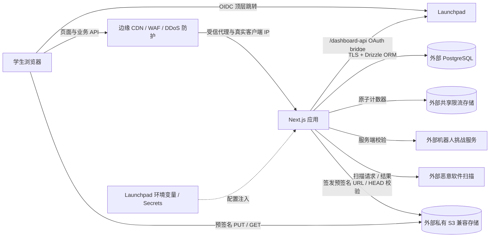

# SHSID Online 产品需求文档（PRD）

> 文档状态：Draft v0.5（M0 技术验证版）
> 更新日期：2026-10-26  
> 第一阶段：Resource Hub + Launchpad 登录/鉴权  
> 技术基线：Launchpad 部署 Next.js + React + TypeScript 应用，外接 PostgreSQL、私有 S3 兼容对象存储、共享限流存储、扫描服务与边缘 WAF/DDoS 防护
> 已选定方案：Launchpad 已识别的 HTTPS 生产域名 + 服务端 OIDC Code/PKCE + 本站服务端会话

## 1. 项目概述

SHSID Online 是一个仅面向 SHSID 学生的校内 C2C 社区。学生可以分享学习资源、提问与回答，并在后续版本中通过类似 Twitter/X 或 Snapchat 群聊的方式进行即时交流。

产品分阶段建设。第一阶段只交付可上线验证的 MVP：

1. 使用 Launchpad 完成学生身份登录和访问控制；
2. 建立无栏目（无 section）的 Resource Hub；
3. 允许登录用户搜索、上传、下载和管理自己的资源；
4. 提供维持学生社区安全所需的最低限度审核与风控能力。

Q&A 和实时 Communication 在后续阶段实现，不进入第一阶段的开发范围。

## 2. 背景与问题

学生资源目前可能散落在聊天群、个人网盘和不同平台中，存在以下问题：

- 资料难以发现，历史内容容易被新消息淹没；
- 缺少统一的学生身份认证，难以限制社区访问范围；
- 上传者和下载者之间缺少可信、可追溯的关系；
- 现有分类体系容易过时，用户常常不知道资料应该放在哪个栏目。

因此，Resource Hub 不设置固定栏目，而以统一搜索框作为主要入口。资源标题、描述、标签、文件名和上传者信息共同参与检索；标签仅作为搜索元数据，不形成独立栏目或强制分类树。

## 3. 产品目标与成功指标

### 3.1 MVP 目标

- 仅允许通过 Launchpad 验证且属于允许组织的用户进入网站；
- 用户能够在 3 分钟内完成一次资源发布；
- 用户能够通过关键词找到相关资源并安全下载；
- 文件流量不经过 Next.js 应用服务器，上传和下载均使用短时效预签名 URL；
- 任何用户上传的文件在对其他学生可见前必须通过恶意软件扫描；
- 通过边缘 DDoS 防护、应用层限流和风险自适应机器人检查，防止自动化滥用拖垮鉴权、搜索、上传或下载服务；
- 管理员能够隐藏违规资源、处理举报，并保留必要的审计信息。

### 3.2 建议的上线后指标

| 指标 | MVP 建议目标 |
|---|---:|
| 登录成功率 | ≥ 98%（排除用户主动取消授权） |
| 上传成功率 | ≥ 95% |
| 搜索结果接口 P95 | ≤ 800 ms |
| 资源下载链接签发成功率 | ≥ 99% |
| 正常已鉴权用户被误限流率 | < 1% |
| 机器人挑战完成率 | ≥ 90%（排除明确自动化流量） |
| 首月有效资源数 | 由产品负责人设定基线后衡量 |
| 搜索无结果率 | 持续记录，首月后制定优化目标 |

“有效资源”指状态为可见、文件可下载且未被判定为重复或违规的资源。

## 4. 用户与权限

### 4.1 用户角色

| 角色 | 权限 |
|---|---|
| 未登录访客 | 仅查看登录页、隐私说明、服务条款和错误页；不能搜索或下载资源 |
| 已验证学生 | 搜索、查看、下载、上传资源；编辑或删除自己发布的资源；举报他人资源 |
| 管理员 | 拥有学生权限；查看举报；隐藏、恢复或下架资源；封禁用户；查看审计记录 |

### 4.2 身份准入规则

MVP 默认采用封闭社区策略：

- Launchpad `userinfo` 返回 `verified: true`；
- `org` 必须匹配服务端配置的 SHSID 组织白名单；
- 本站用户状态必须为 `active`；
- 以上规则不满足时，拒绝创建本站会话并展示明确但不过度泄露信息的错误说明。

`org` 的实际值、`verified` 的业务含义及是否需要额外的 `allows` capability，必须在 M0 联调中由 Launchpad 维护者确认。在这些值未确认前不得开放正式登录；禁止仅依据邮箱后缀完成鉴权。

## 5. 分阶段范围

### Phase 1：MVP

包含：

- Launchpad OIDC 登录、登出、会话管理和访问控制；
- 首次登录时自动创建本站用户；
- Resource Hub 搜索与结果列表；
- 资源详情、上传、下载、编辑和删除；
- 上传文件恶意软件扫描、失败隔离与超时处理；
- “我的资源”；
- 基础举报、管理员隐藏资源和用户封禁；
- 边缘 DDoS/WAF 防护、分级限流、风险自适应机器人检查和滥用监控；
- 基础日志、错误监控和核心事件统计。

不包含：

- Q&A、评论、点赞、收藏、关注、私信；
- 实时群聊、阅后即焚、消息推送；
- 复杂推荐算法、积分或排行榜；
- 固定学科栏目和多级分类导航；
- 多文件资源包、在线协作编辑、文件在线转码。

### Phase 2：Q&A

- 发布问题、回答、评论和最佳答案；
- 标签和搜索复用 Resource Hub 的检索能力；
- 举报、审核、通知和内容状态管理；
- 资源与问答之间可相互引用。

### Phase 3：Communication

- 创建和加入群聊；
- 实时文本、图片和资源卡片消息；
- 未读状态、提及、成员和群权限；
- 消息保留时间与“类似 Snapchat”的临时消息策略；
- WebSocket/SSE、离线重连、消息顺序和滥用防护。

Phase 3 开始前必须明确：群聊是公开还是邀请制、消息是否自动消失、截屏/转发规则、内容留存与校方合规要求。

## 6. MVP 核心用户故事

### 6.1 登录

- 作为 SHSID 学生，我希望用 Launchpad 登录，不需要新建一套账号密码。
- 作为未获准用户，我希望知道为什么不能进入，以及可以向谁求助。
- 作为用户，我希望退出本站后，本地会话立即失效。

### 6.2 搜索和发现资源

- 作为学生，我希望进入 Resource Hub 后立即看到居中的搜索框。
- 作为学生，我希望输入课程名、主题、文件名或关键词后获得相关结果。
- 作为学生，我希望看到资源标题、简述、文件类型、大小、上传者和发布时间。
- 作为学生，我希望在没有结果时得到修改关键词或上传资源的引导。

### 6.3 发布和管理资源

- 作为学生，我希望上传一个受支持的文件并填写标题、描述和可选标签。
- 作为上传者，我希望修改资源的标题、描述和标签，但不能静默替换已经发布的文件。
- 作为上传者，我希望删除自己的资源；删除后其他用户无法继续获得新的下载链接。
- 作为管理员，我希望隐藏违规或有风险的资源，并记录操作原因。

## 7. 功能需求

需求优先级定义：P0 为 MVP 上线必需，P1 为 MVP 上线后尽快补齐，P2 为后续增强。

### 7.1 Launchpad 登录与本站会话

| ID | 优先级 | 需求 |
|---|---|---|
| AUTH-01 | P0 | 登录采用 OIDC Authorization Code + PKCE（S256）流程，并校验 `state`；建议同时使用 `nonce`。 |
| AUTH-02 | P0 | 生产应用使用 Launchpad 已识别且已启用 HTTPS 的域名，并通过该域名下的 `/dashboard-api/` bridge 访问 Launchpad OAuth 端点。 |
| AUTH-03 | P0 | 回调收到 code 后必须立即且仅交换一次；失败时提供可重试的错误页。 |
| AUTH-04 | P0 | access token 不做本地 HS256 验签，身份以 Launchpad `/oauth/userinfo` 返回结果为准。 |
| AUTH-05 | P0 | 使用 Launchpad `sub` 作为外部身份唯一键；email 只能作为资料字段，不作为主键。 |
| AUTH-06 | P0 | 登录成功后签发本站随机会话标识，并通过 `HttpOnly + Secure + SameSite=Lax` Cookie 保存。数据库仅保存会话标识哈希。 |
| AUTH-07 | P0 | 全站业务路由、资源元数据接口和预签名 URL 接口均要求有效本站会话。 |
| AUTH-08 | P0 | 登出使本站会话服务端失效并清除 Cookie；同时说明 Launchpad SDK 的本地登出不等于撤销 Launchpad 全局会话。 |
| AUTH-09 | P0 | 保存最近登录时间；不将 Launchpad access token、id token 写入日志。 |
| AUTH-10 | P0 | 生产环境显式设置 `LAUNCHPAD_OIDC_DEV=0`；发布健康检查必须验证 HTTPS、bootstrap、callback 和 `Secure` Cookie 往返。 |
| AUTH-11 | P0 | 在 Launchpad 维护者确认之前，本站会话绝对有效期不超过 1 小时；确认可独立长会话后，再通过配置调整。 |
| AUTH-12 | P0 | 管理员封禁用户时，必须立即撤销该用户的全部本站会话。 |

推荐由 Next.js Route Handlers 完成 PKCE 回调、`userinfo` 校验和本站会话签发。若采用浏览器 drop-in SDK，必须补充“如何把浏览器身份安全地转换为服务端会话”的设计，禁止仅凭客户端上报的用户对象创建账号。

### 7.2 Resource Hub 首页与搜索

| ID | 优先级 | 需求 |
|---|---|---|
| SEARCH-01 | P0 | Resource Hub 不展示固定栏目；搜索框是页面主入口。 |
| SEARCH-02 | P0 | 搜索覆盖标题、描述、标签和原始文件名。 |
| SEARCH-03 | P0 | 空查询可显示最近发布的有效资源，但不能被呈现为栏目。 |
| SEARCH-04 | P0 | 结果只包含状态为 `active` 的资源。 |
| SEARCH-05 | P0 | 支持按相关性和最新发布时间排序，默认按相关性；空查询默认按最新排序。 |
| SEARCH-06 | P0 | 搜索结果分页或游标加载，每次默认 20 条。 |
| SEARCH-07 | P0 | 搜索词去除首尾空格并限制长度；必须使用参数化查询。 |
| SEARCH-08 | P1 | 支持拼写模糊匹配、高亮命中词和文件类型筛选。 |

MVP 建议先使用 PostgreSQL Full Text Search 配合 `pg_trgm`，避免过早引入独立搜索服务。英文课程名和文件名可用加权全文索引；中英文混合、缩写和模糊匹配由 trigram 补充。排名建议为：标题 > 标签 > 文件名 > 描述。

### 7.3 资源上传

| ID | 优先级 | 需求 |
|---|---|---|
| UPLOAD-01 | P0 | 用户填写标题、描述、可选标签并选择单个文件。 |
| UPLOAD-02 | P0 | 标题 1–120 字符；描述最多 2,000 字符；标签最多 10 个、每个最多 30 字符。 |
| UPLOAD-03 | P0 | MVP 单文件最大 50 MB，该值必须可通过环境配置调整。 |
| UPLOAD-04 | P0 | 默认允许 PDF、DOCX、PPTX、XLSX、TXT、PNG、JPG/JPEG；拒绝可执行文件、脚本、宏文件和压缩包。 |
| UPLOAD-05 | P0 | 服务端创建 `pending` 记录和不可预测的 object key，再签发短时效预签名 PUT URL。 |
| UPLOAD-06 | P0 | 浏览器直接上传至私有 S3 bucket，文件内容不经过 Next.js 服务。 |
| UPLOAD-07 | P0 | 上传完成后调用 complete 接口；服务端通过对象存储 HEAD 检查对象是否存在、大小是否一致、Content-Type 是否允许。 |
| UPLOAD-08 | P0 | HEAD 校验通过后资源进入 `scanning`，只有扫描通过才可进入 `active`；失败或超时始终不可见。 |
| UPLOAD-09 | P0 | object key 与用户提交的原始文件名分离；原始文件名仅作为经过清理的展示元数据。 |
| UPLOAD-10 | P0 | 防止重复提交 complete；整个完成操作必须幂等。 |
| UPLOAD-11 | P0 | 文件进入 `scanning` 状态，经恶意软件扫描通过后才能进入 `active`；扫描失败、不可用或超时时进入隔离状态，禁止 fail-open。 |
| UPLOAD-12 | P1 | 计算并保存 SHA-256，用于重复文件提示和安全追踪。 |
| UPLOAD-13 | P0 | 对过期 `pending/` 对象同时使用应用对账清理与对象存储 Lifecycle 规则；若采用 multipart upload，还必须自动终止未完成分片。 |

扫描是向普通学生开放前的强制门槛。在扫描未完成前，只允许小规模、明确授权且不含真实敏感资料的技术验证，不得作为学生内测发布。

### 7.4 资源详情与下载

| ID | 优先级 | 需求 |
|---|---|---|
| RESOURCE-01 | P0 | 详情页显示标题、描述、标签、文件名、类型、大小、上传者显示名和发布时间。 |
| RESOURCE-02 | P0 | 下载前由服务端重新校验登录状态、用户状态和资源状态。 |
| RESOURCE-03 | P0 | 校验通过后签发 60–300 秒有效的预签名 GET URL，并设置下载文件名。 |
| RESOURCE-04 | P0 | S3 bucket 和对象不得公开读取；数据库中不得保存永久公开 URL。 |
| RESOURCE-05 | P0 | 只有作者或管理员可以编辑元数据；只有作者或管理员可以删除资源。 |
| RESOURCE-06 | P0 | 删除采用数据库软删除并立即停止签发新下载链接；对象文件由后台任务延迟删除。 |
| RESOURCE-07 | P0 | 对已删除、隐藏、隔离或不存在的资源返回统一的不可用页面，避免泄露审核细节。 |
| RESOURCE-08 | P1 | 记录聚合下载次数；日志不得长期保存完整预签名 URL。 |

### 7.5 举报和基础管理

| ID | 优先级 | 需求 |
|---|---|---|
| MOD-01 | P0 | 登录用户可按“版权/隐私、恶意文件、不当内容、垃圾内容、其他”举报资源。 |
| MOD-02 | P0 | 同一用户对同一资源只能存在一个未处理举报。 |
| MOD-03 | P0 | 管理员可查看待处理举报并隐藏、恢复或下架资源。 |
| MOD-04 | P0 | 管理操作必须记录操作者、时间、对象、动作和原因。 |
| MOD-05 | P0 | 被封禁用户不能上传、下载或获得新的预签名 URL。 |
| MOD-06 | P1 | 达到风险阈值时自动临时隐藏资源，等待人工复核。 |

### 7.6 限流、DDoS 防护与机器人检查

| ID | 优先级 | 需求 |
|---|---|---|
| SEC-01 | P0 | 生产流量必须先经过可吸收容量型攻击的 CDN/反向代理与 WAF，再到达 Next.js origin；不得存在可绕过同等防护的公开 origin 入口。 |
| SEC-02 | P0 | 应用层对 IP、本站用户/会话和操作类型组合限流；多实例部署时使用共享、原子的限流存储，禁止仅依赖单进程内存计数器。 |
| SEC-03 | P0 | 只有受信任的边缘代理可写入客户端 IP 头；origin 必须忽略或覆盖公网客户端伪造的 `X-Forwarded-For` 等头部。 |
| SEC-04 | P0 | 鉴权前先执行 IP/总流量粗限流，再进行必要的会话与用户状态查询，鉴权后以用户配额为主执行操作级限流；超额返回 `429 Too Many Requests` 和合理的 `Retry-After`，不继续执行业务查询、对象存储签名或扫描；错误响应不得泄露账号、资源或审核状态。 |
| SEC-05 | P0 | 机器人检查采用风险自适应触发：本站异常授权发起、短时高频搜索/下载、批量上传意图或举报时按风险要求挑战；不依据 Launchpad 密码失败次数，不将正常取消授权视为攻击；正常低风险用户不应每次操作都被挑战。 |
| SEC-06 | P0 | 机器人挑战 token 必须在服务端校验成功后才允许原操作；校验其有效期、hostname/action 绑定并防止重放，禁止仅依赖客户端“已通过”状态。 |
| SEC-07 | P0 | 挑战提供可访问的替代方式，且不得用于跨站广告跟踪；挑战服务不可用时，对已触发高风险的写操作 fail-closed，对低风险读操作改用更严格的限流而不是全站瘫痪。 |
| SEC-08 | P0 | 限流阈值、挑战触发阈值与封禁时间必须可配置，可在不发版的情况下紧急收紧；限流键和挑战 token 不得写入普通应用日志。 |
| SEC-09 | P0 | 监控总请求率、`429` 比例、WAF 拦截量、挑战触发/通过率、各类高风险操作的被拒数量，并对持续异常流量告警。 |

OAuth 防护边界与执行顺序：

- Launchpad 负责其登录、密码验证和认证侧防护；本站负责授权入口、回调、本站会话和业务接口，不重复建设密码登录风控。
- 浏览器经本站 `/api/auth/launchpad/start` 跳转 Launchpad，再返回本站 callback；即使已有 Launchpad 登录状态，本站授权入口和回调仍受本站限流约束。
- 授权入口使用宽松的 IP 总量保护，并对单个浏览器的重复发起进行短时限制。临时 Cookie 可被清除，不能作为唯一防线；不得仅因同一校园 IP 下多个正常用户登录而触发挑战。
- callback 先通过粗限流，再校验短时登录事务和 `state`，使用原 PKCE verifier 交换 code；同一登录事务只允许一次有效处理，重复回调不得重复交换 code 或签发会话。仅允许必要的事务查询/原子状态更新，校验失败不得调用 token/userinfo；callback 中不插入交互挑战。
- 风险信号使用本站可观测的异常授权发起、无效 `state` 和重复回调；正常取消授权、平台故障单独统计，不计为恶意登录失败。本站不假设能够获取 Launchpad 密码失败次数。

以下是 MVP 初始阈值，必须按内测数据调整，且不代替边缘 DDoS 防护。OAuth 总量阈值须经集中登录测试后确定，不沿用每 IP 5 次/10 分钟的授权入口或 30 次/10 分钟的回调硬上限：

| 操作 | 用户/会话限制 | IP 限制 | 额外措施 |
|---|---:|---:|---|
| 本站 OAuth 授权入口 | 无已验证用户键；单浏览器重复发起采用可配置短时限制 | 宽松总量阈值，按校园集中登录峰值与服务容量验证后配置 | 仅针对异常重复发起按风险挑战 |
| 本站 OAuth callback | 每个有效登录事务只处理一次；重复请求不重复交换 code/签发会话 | 总量及无效回调阈值分别配置，按集中登录测试确定 | 校验事务、state 与 PKCE；不插入交互挑战 |
| 搜索 | 60 次 / 分钟 | 120 次 / 分钟 | 持续满额或异常查询模式触发挑战/减速 |
| 上传意图 | 10 次 / 小时 | 30 次 / 小时 | 短时批量请求触发挑战 |
| complete | 20 次 / 小时 | 60 次 / 小时 | 重复请求依赖幂等而不是反复扫描 |
| 下载链接签发 | 120 次 / 小时 | 300 次 / 小时 | 异常批量下载触发挑战或临时冻结 |
| 举报 | 10 次 / 天 | 30 次 / 天 | 重复举报拒绝；异常批量举报触发挑战 |

### 7.7 外部服务与环境配置

| ID | 优先级 | 需求 |
|---|---|---|
| ENV-01 | P0 | Launchpad 只部署 Next.js 应用计算层；PostgreSQL、S3 兼容存储、共享限流存储、恶意软件扫描和机器人挑战可作为独立外部服务。 |
| ENV-02 | P0 | 本地开发使用未提交的 `.env.local`；生产变量和密钥通过 Launchpad 部署环境变量/Secrets 注入，禁止将真实值写入仓库、构建产物或镜像。 |
| ENV-03 | P0 | 除明确可公开的机器人挑战 site key 外，密钥类变量禁止使用 `NEXT_PUBLIC_` 前缀，且只能在服务端模块中读取。 |
| ENV-04 | P0 | 应用启动时使用运行时 schema 验证必需环境变量；缺失、类型错误或使用占位值时拒绝启动。 |
| ENV-05 | P0 | 外部 PostgreSQL 连接必须使用 TLS、最小权限账号和受控连接池；连接上限必须与 Launchpad 实例数量和数据库配额匹配。 |
| ENV-06 | P0 | S3 凭据使用最小权限，只允许指定 bucket/prefix 的必要操作；CORS 只允许生产域名及必要的 `PUT/GET/HEAD` 方法和头部。 |
| ENV-07 | P0 | 所有外部服务必须使用 TLS，并在 M0 验证 Launchpad 的出口网络、DNS、防火墙/允许列表、延迟、超时和故障行为。 |
| ENV-08 | P0 | 密钥必须有明确所有者、轮换流程和撤销流程；轮换后旧凭据不得继续访问生产服务。 |

## 8. 关键业务流程

### 8.1 登录流程

1. 用户点击“使用 Launchpad 登录”。
2. 本站从自身 origin 调用 `/dashboard-api/oauth/bootstrap`，获取与 origin 绑定的 `client_id` 和 redirect URI。
3. 本站生成 PKCE verifier/challenge、`state` 和 `nonce`，将必要的临时状态放入短时效、签名或加密的安全 Cookie。
4. 浏览器顶层跳转至 Launchpad `/oauth/authorize`。
5. 用户在 Launchpad 登录并同意授权；同意页每次都会出现。
6. Launchpad 将一次性 code 返回 `/__lp_auth/callback`。
7. 本站校验 `state`，使用原 verifier 换取 token，并调用 `/oauth/userinfo`。
8. 本站校验 `sub`、`verified`、`org` 和用户封禁状态，创建或更新用户。
9. 本站签发 HttpOnly 会话 Cookie，并跳转回登录前页面或 Resource Hub。

### 8.2 上传流程

1. 客户端提交文件名、大小、Content-Type 和资源元数据。
2. 服务端校验权限、频率、字段、文件类型和大小。
3. 服务端创建 `pending` 资源，生成 object key 和预签名 PUT URL。
4. 客户端直传对象存储，并显示真实进度。
5. 客户端调用 complete 接口。
6. 服务端 HEAD 校验对象；通过后必须进入 `scanning`。
7. 扫描通过后进入 `active`；失败或超时进入 `quarantined`。
8. 客户端在扫描期间显示处理状态，激活后跳转资源详情。

### 8.3 下载流程

1. 用户在资源详情点击下载。
2. 服务端校验用户、资源状态和下载限流。
3. 服务端生成短时效预签名 GET URL。
4. 客户端直接从对象存储下载。

## 9. 页面与信息架构

| 页面 | MVP 主要内容 |
|---|---|
| `/login` | 产品说明、Launchpad 登录按钮、隐私/条款入口、登录错误提示 |
| `/resources` | 主搜索框、上传入口、搜索结果或最近资源、分页/加载更多 |
| `/resources/new` | 文件选择、标题、描述、标签、上传进度和错误恢复 |
| `/resources/[id]` | 资源元数据、下载、举报；作者可编辑/删除 |
| `/me/resources` | 当前用户上传的 active、pending、hidden 和 failed 资源 |
| `/admin/reports` | 举报队列、资源状态、处理动作和原因 |
| `/auth/error` | 授权取消、组织不允许、验证失败、平台不可用等可操作错误提示 |

移动端优先，最低支持 360 px 宽度。搜索和下载应可仅使用键盘完成，主要表单字段包含可见 label，错误信息不能只依靠颜色传达。

## 10. 技术架构

### 10.1 技术原则

- Next.js 同时承担前端渲染、业务 API、OAuth 回调和后台管理接口；
- OAuth bootstrap、code exchange、`userinfo` 校验与本站会话签发均在服务端完成；禁止仅凭客户端 SDK 上报的用户对象建立会话；
- Next.js origin 前必须有边缘 DDoS/WAF 防护；origin 仅信任已配置的代理链，不信任公网客户端自带的转发 IP 头；
- 应用层限流使用共享原子存储；机器人挑战结果在服务端与原操作同步校验；
- 鉴权前先做 IP/总流量粗限流；允许必要的会话、用户状态或 OAuth 事务查询，再执行用户/操作级限流，拒绝后不执行后续高成本业务操作；
- Launchpad 部署单元只承载 Next.js 应用计算层；持久状态和文件使用外部 PostgreSQL 与 S3 兼容存储；
- 外部 PostgreSQL 存储用户、会话、资源元数据、举报和审计记录；
- 使用 Drizzle ORM 管理 schema 和 migration（原始需求中的 “prizzle” 按 Drizzle 理解）；
- 文件只存储在 S3 兼容对象存储中，bucket 默认为 private；
- 服务端掌握 S3 凭据，仅向已鉴权用户签发单次用途、短时效 URL；
- 定时任务对账并清理过期 `pending` 记录、孤儿对象和软删除对象；对象存储同时为 `pending/` 前缀配置 Lifecycle 兜底；
- 本地开发使用未提交的 `.env.local`；生产密钥和连接串由 Launchpad 环境变量/Secrets 提供，不进入仓库、镜像或构建产物。

### 10.2 环境变量合同

下表只定义变量名和用途，不在文档中填写任何真实值：

| 分类 | 环境变量 | 要求 |
|---|---|---|
| 应用 | `APP_BASE_URL` | HTTPS 生产 origin，启动时校验 |
| 会话 | `SESSION_SECRET`、`SESSION_TOKEN_PEPPER` | 高强度、仅服务端可见、可轮换 |
| PostgreSQL | `DATABASE_URL` | 包含 TLS 要求；只提供给服务端 |
| S3 | `S3_ENDPOINT`、`S3_REGION`、`S3_BUCKET`、`S3_ACCESS_KEY_ID`、`S3_SECRET_ACCESS_KEY`、`S3_FORCE_PATH_STYLE` | 最小权限凭据；endpoint 必须为 HTTPS |
| 限流 | `RATE_LIMIT_URL`、`RATE_LIMIT_TOKEN` | 共享原子存储；token 仅服务端可见 |
| 机器人检查 | `NEXT_PUBLIC_BOT_SITE_KEY`、`BOT_VERIFY_URL`、`BOT_VERIFY_SECRET` | 只有 site key 可公开；verify secret 仅服务端可见 |
| 恶意软件扫描 | `MALWARE_SCAN_URL`、`MALWARE_SCAN_TOKEN` | 仅服务端可见；配置明确超时 |
| Launchpad 运行环境 | `LAUNCHPAD_OIDC_DEV=0` | 生产强制值，禁止开发 origin 覆盖 |

配置管理规则：

- 仓库只提交不含真实值的 `.env.example`，`.env*` 默认忽略，仅对 `.env.example` 例外。
- 启动时对所有必需变量做 schema 校验，缺失、错误或占位值导致启动失败。
- 不在日志、错误页、前端 bundle、构建输出或监控 metadata 中输出变量值。
- 密钥按服务独立分配并按期轮换；怀疑泄露时立即撤销并更换。

## 11. Launchpad 部署与鉴权结论

### 11.1 已选定的生产方案

按照《Sign in with Launchpad》说明，MVP 固定采用：**将 Next.js 应用部署为 Launchpad 已知站点，并使用 Launchpad 已绑定、已启用 HTTPS 的生产域名。**

身份接入固定采用 **Next.js 服务端 OIDC Authorization Code + PKCE**，通过同源 `/dashboard-api/` bridge 访问 Launchpad，再签发与 Launchpad token 分离的本站服务端会话。浏览器 drop-in SDK 可用于辅助交互，但不是本站信任边界。

不能把任意自托管域名直接当作普通公开 OAuth 客户端使用，原因是：

- `/oauth/bootstrap` 根据受信任反向代理写入的 `X-Forwarded-Host` 识别应用 origin；
- 只有“已部署站点或已绑定域名”能够注册，未知 origin 会返回 `403 origin is not a known Launchpad app`；
- 生产环境不接受客户端在请求体中随意声明 origin；`devOrigin` 只用于启用了开发模式的本地开发；
- SDK 和 OAuth 请求依赖应用自身域名下的 `/dashboard-api/` bridge。

### 11.2 部署方案决策记录

| 方案 | 可行性 | 建议 |
|---|---|---|
| A. Next.js 部署到 Launchpad，并绑定 HTTPS 生产域名 | 已由说明文档支持 | **MVP 已选定** |
| B. 使用 Launchpad 自动应用 URL | 可用，但默认可能只有 HTTP | 仅在已启用 `LAUNCHPAD_APPS_HTTPS=1` 并通过验证时可用于生产 |
| C. 计算服务完全自托管，生产域名由 Launchpad 识别并代理 OAuth bridge | 条件性可行，需要平台维护者配置 | MVP 不采用；后续若有明确基础设施需求再评估 |
| D. 任意外部域名直接调用 Launchpad OAuth API | 按当前说明不可行 | 禁止作为 MVP 方案 |

方案 C 不是“直接调用公开 API”：生产 origin 仍必须被 Launchpad 识别，且前置代理必须可靠地将 `/dashboard-api/` 转发到 Launchpad host-server，并设置可信的 `X-Forwarded-Host`。不得允许公网客户端自行注入该请求头。

PostgreSQL 和 S3 对象存储可以独立部署；上述限制主要针对应用 origin、OAuth bootstrap 和 bridge，不要求数据库与文件存储和 Launchpad 位于同一服务进程。

### 11.3 上线前必须完成的 Launchpad 验证

- 确认生产域名能成功调用 `/dashboard-api/oauth/bootstrap`；
- 确认生产域名使用 HTTPS，并完成一次 `Secure` 本站会话 Cookie 的写入与回传验证；
- 确认生产环境 `LAUNCHPAD_OIDC_DEV=0`，且客户端提交 `devOrigin` 无法绕过 origin 识别；
- 确认 `client_id`、redirect URI 和 `/__lp_auth/callback` 一致；
- 确认 `/dashboard-api/oauth/token` 与 `/oauth/userinfo` 可用；
- 确认 `org` 的实际 SHSID 值和 `verified` 的业务含义；
- 确认是否需要为本应用申请专属 `allows` capability；
- 确认本站会话是否可长于 Launchpad 约 1 小时的 access token 生命周期；
- 在自定义域名上遇到 `/dashboard-api/*` 404 时重新 provision vhost；
- 使用 Launchpad 提供的 `lp oidc <id>` 检查 deployed、integrated 和 registered 状态。

上述任一项未通过时，M0 判定为未完成，不得进入面向学生的内测发布。

## 12. 建议数据模型

### `users`

- `id` UUID，主键
- `launchpad_sub` text，唯一、不可变
- `email` text
- `display_name` text
- `avatar_url` text，可空
- `org` text
- `verified` boolean
- `role` enum: `student | admin`
- `status` enum: `active | suspended`
- `created_at`、`updated_at`、`last_login_at`

### `sessions`

- `id` UUID
- `user_id` FK
- `token_hash` text，唯一
- `expires_at`、`created_at`、`last_seen_at`
- `revoked_at`，可空
- 可选：粗粒度设备/IP 信息，仅按隐私政策和最小必要原则保存

### `resources`

- `id` UUID
- `author_id` FK
- `title`、`description`
- `tags` text[]
- `original_filename`、`object_key`
- `mime_type`、`size_bytes`、`sha256`（P1）
- `status` enum: `pending | scanning | active | hidden | quarantined | deleted | failed`
- `moderation_reason`，仅管理员可见
- `created_at`、`updated_at`、`published_at`、`deleted_at`
- 搜索向量与必要的 GIN/GiST 索引

### `resource_reports`

- `id` UUID
- `resource_id`、`reporter_id`
- `reason` enum、`details`
- `status` enum: `open | resolved | dismissed`
- `handled_by`、`handled_at`、`resolution_note`
- `created_at`

### `audit_logs`

- `id` UUID
- `actor_id`
- `action`、`target_type`、`target_id`
- `metadata` jsonb（禁止写入 token、预签名 URL 和不必要的个人信息）
- `created_at`

## 13. 建议 API 边界

| 方法与路径 | 用途 |
|---|---|
| `GET /api/auth/launchpad/start` | 生成 PKCE 状态并跳转 Launchpad |
| `GET /__lp_auth/callback` | 校验回调、获取 userinfo、创建本站会话 |
| `POST /api/auth/logout` | 撤销本站会话 |
| `GET /api/me` | 返回最小化的当前用户资料 |
| `GET /api/resources?q=&cursor=&sort=` | 搜索或获取最近资源 |
| `POST /api/resources/upload-intents` | 创建 pending 记录并获得预签名 PUT URL |
| `POST /api/resources/:id/complete` | 校验对象并完成发布 |
| `GET /api/resources/:id` | 获取资源详情 |
| `PATCH /api/resources/:id` | 作者或管理员编辑元数据 |
| `DELETE /api/resources/:id` | 软删除资源 |
| `POST /api/resources/:id/download` | 校验后获得预签名 GET URL |
| `POST /api/resources/:id/reports` | 举报资源 |
| `GET /api/admin/reports` | 管理员查看举报 |
| `POST /api/admin/resources/:id/moderate` | 隐藏、恢复或下架资源 |

所有变更接口必须实施 CSRF 防护或严格的同源策略，执行服务端鉴权和资源级权限检查，并按用户/会话、IP 和操作类型组合限流。机器人挑战 token 随受保护的原请求提交并在服务端校验，不单独设置可被重放的“验证成功”接口。

## 14. 非功能需求

### 14.1 安全与隐私

- 全站生产环境强制 HTTPS；
- 生产环境必须显式禁用 Launchpad OIDC 开发 origin 覆盖（`LAUNCHPAD_OIDC_DEV=0`）；
- S3 bucket 禁止公开读取与公开列举；
- access token、id token、会话明文、预签名 URL 不进入应用日志；
- Cookie 设置 `HttpOnly`、`Secure`、`SameSite=Lax`，并定期轮换会话；
- 文件类型不能只相信扩展名和浏览器 Content-Type，应检查对象元数据并在扫描阶段识别真实格式；
- 边缘层限制总请求率、并发连接、异常路径和请求体大小；应用层对登录、搜索、上传意图、complete、下载链接签发和举报分别限流；
- 对可疑自动化流量执行服务端可验证的机器人挑战，并保留可访问性与隐私友好的备选路径；
- UI 输出用户文本时进行安全转义；资源描述 MVP 不支持任意 HTML；
- 制定隐私说明、可接受使用规则、举报处理规则和数据删除策略；
- 对学生数据遵循数据最小化原则，不收集与功能无关的信息。

### 14.2 性能与可靠性

- 常规页面 P95 服务端响应目标 ≤ 1 秒（不含文件传输）；
- 搜索接口 P95 目标 ≤ 800 ms；
- 数据库 migration 可回滚或有明确的前向修复方案；
- 生产环境定期备份 PostgreSQL，并验证恢复流程；
- 对象存储上传中断可重试，complete 接口幂等；
- 过期 `pending` 对象同时由应用对账任务和对象存储 Lifecycle 清理，并监控清理失败数量；
- Launchpad 不可用时不得错误放行用户，应展示可重试状态；
- 关键任务包含结构化日志和错误追踪，但日志须脱敏。
- 流量突增时应在边缘或粗限流层快速拒绝，此时不查询应用数据库；用户级限流可在必要的会话与用户状态查询之后执行，拒绝后不得继续执行业务查询、对象存储签名或文件扫描等高成本操作；

### 14.3 兼容性与可访问性

- 支持当前及前一个主要版本的 Chrome、Safari 和 Edge；
- 支持手机与桌面布局；
- 主要流程达到 WCAG 2.1 AA 的基本要求：键盘操作、焦点可见、颜色对比、表单 label 和错误提示。

## 15. MVP 验收标准

### 15.1 登录与访问控制

- 未登录用户访问业务页会被引导到登录页，原目标路径在登录后恢复；
- 合法 SHSID 用户能够完成 Launchpad 授权并进入 Resource Hub；
- `state` 不匹配、code 重用、code 过期、userinfo 401、`verified=false` 或 org 不允许时，系统拒绝登录；
- 未知生产 origin 调用 bootstrap 时，不以开发模式绕过；
- 生产域名为 HTTPS，登录后浏览器能够写入并回传 `Secure` 本站会话 Cookie；
- 生产配置中 `LAUNCHPAD_OIDC_DEV=0`；
- 退出后原本站会话不能继续访问任何受保护 API；
- 任何日志和错误监控中均找不到明文 token。

### 15.2 Resource Hub

- 首页没有固定栏目，搜索框是主要入口；
- 标题、标签、文件名和描述中的关键词均可检索到对应 active 资源；
- hidden、deleted、pending、quarantined 资源不会出现在搜索结果中；
- 空结果页面允许用户修改搜索或进入上传页；
- 同分结果排序稳定，分页不会无故重复或漏项。

### 15.3 上传与下载

- 合法用户能直传一个受支持且不超过限制的文件；
- 新上传文件在扫描完成前不会出现在搜索、详情或下载接口；扫描失败、不可用或超时时不会自动放行；
- 超大文件、不允许的格式、伪造的 complete 请求和他人资源操作均被拒绝；
- 未完成上传不会公开显示，并能被后台任务清理；
- 停止于上传或 complete 之前的对象能在设定 TTL 后被对账任务或 Lifecycle 规则清理；
- 下载链接仅在鉴权后签发、短时有效，过期后不可使用；
- 删除或隐藏资源后，系统不再签发新下载链接；
- S3 原始对象无法通过公开 URL 直接访问。

### 15.4 管理与审计

- 学生能举报资源但不能访问管理接口；
- 管理员能处理举报、隐藏资源和填写原因；
- 管理动作在审计表中可查，且不包含敏感 token；
- 被封禁用户的既有会话在要求的时限内失效。

### 15.5 限流、DDoS 防护与机器人检查

- 从非受信任网络无法绕过边缘/WAF 直接访问 origin，或 origin 对该流量实施完全等价的防护；
- 伪造 `X-Forwarded-For` 不会改变应用识别的客户端 IP；
- 在单实例和多实例部署下，同一用户/IP 的限流计数均不能通过切换实例规避；
- 超过各操作配额时返回 `429` 和 `Retry-After`；粗限流拒绝时不查询应用数据库，用户级限流允许此前必要的会话与用户状态查询，拒绝后不得执行业务查询、签名或扫描；
- 上线前记录预计同一校园出口的集中登录人数与峰值，在该负载及约定余量下完成授权入口和 callback 测试；正常用户不得因共享 IP 被本站误拦。OAuth 阈值配置及测试结果作为发布验收证据；
- 单浏览器异常重复发起、无效 state 和重复 callback 能被限制；清除临时 Cookie 不得绕过总量保护；重复 callback 不重复交换 code 或创建会话；
- 已登录 Launchpad 的授权往返也通过上述测试；正常取消授权、平台故障与无效回调分类统计，callback 不出现交互挑战；
- 只修改客户端“已通过挑战”状态、伪造 token、过期 token、错误 hostname/action 或重放 token 均不能绕过机器人检查；
- 正常低风险已鉴权用户可完成核心流程而不被每次挑战；学校共享出口 IP 不会因为单一用户行为被长时间整体封禁；
- 挑战服务不可用时，高风险写操作不会 fail-open，低风险读操作在更严格限流下仍可用；
- 压力/攻击演练中，拦截、`429`、挑战和异常流量指标可被观测并触发告警。

### 15.6 外部服务与配置安全

- Launchpad 应用重启、重新部署或回滚后，PostgreSQL 数据、S3 对象与未过期本站会话不会丢失；
- 缺少必需环境变量、变量格式错误或使用占位值时，应用拒绝启动并给出不含敏感值的定位信息；
- 仓库、前端 bundle、部署镜像、构建日志和错误监控中均找不到真实生产凭据；
- Launchpad 到 PostgreSQL、S3、限流、扫描和挑战服务的连接均使用 TLS，超时与故障行为符合各功能的 fail-closed/降级要求；
- 数据库连接池在计划实例数下不超过数据库连接配额，并能从短时网络中断恢复；
- S3 CORS 拒绝非允许 origin、非允许方法和非允许头部；S3 凭据无法访问范围外的 bucket/prefix；
- 轮换数据库、S3 或第三方服务凭据后，新凭据可用且旧凭据已撤销。

## 16. 里程碑建议

| 里程碑 | 交付内容 | 完成条件 |
|---|---|---|
| M0：技术验证 | HTTPS 生产域名；Launchpad bootstrap、回调、userinfo 和 Secure Cookie；外部 PostgreSQL、S3 PUT/GET、扫描与清理；边缘/WAF、共享限流和机器人挑战；生产 Secrets 注入与轮换 | 在目标域名完成端到端 spike；确认 `org`/`verified`/`allows`/会话政策、外部服务与凭据责任人；`LAUNCHPAD_OIDC_DEV=0`；无关键未知项 |
| M1：身份与骨架 | 登录/登出、本站会话、用户表、受保护路由、基础页面 | 鉴权验收用例通过 |
| M2：Resource Hub | 上传、complete、搜索、详情、下载、我的资源 | 核心资源流程端到端通过 |
| M3：安全与管理 | 举报、隐藏、封禁、边缘/WAF、共享限流、机器人挑战、审计、清理任务 | 安全与管理验收用例及压力/滥用演练通过 |
| M4：内测上线 | 监控、备份、隐私/规则、兼容性和小范围试用 | 无阻断级缺陷，完成回滚演练 |

不在需求未澄清的情况下写死具体日历日期。完成 M0 后再依据团队人数和技术验证结果估算工期。

## 17. 风险与应对

| 风险 | 影响 | 应对 |
|---|---|---|
| 自托管域名不被 Launchpad 识别 | 生产环境无法 bootstrap | MVP 优先部署到 Launchpad；自托管前由平台维护者完成域名识别和 bridge 验证 |
| 自定义域名缺少 `/dashboard-api/` bridge | OAuth 请求 404 | 重新 provision vhost，并加入部署健康检查 |
| 自动应用 URL 默认可能只有 HTTP | `Secure` Cookie 无法工作，且缺少浏览器安全上下文 | 生产绑定 HTTPS 自定义域名，或启用并验证 `LAUNCHPAD_APPS_HTTPS=1`；M0 执行 Cookie 往返测试 |
| 生产环境保留 OIDC 开发模式 | 代理错误时可能接受客户端声明的 `devOrigin` | 生产显式设置 `LAUNCHPAD_OIDC_DEV=0`，并纳入发布检查 |
| access/id token 约 1 小时，未提供 refresh-token 刷新流程 | 重跑授权流程可能影响体验 | 在平台确认前本站会话不超过 1 小时；确认后再设定独立会话时长和敏感操作重新验证 |
| consent 每次授权都出现 | 登录体验比普通 SSO 更长 | 登录前明确说明；避免不必要地触发重新授权 |
| 学生上传恶意或侵权文件 | 安全、隐私和合规风险 | 私有存储、类型限制、P0 扫描、fail-closed 隔离、举报、下架和审计 |
| 无栏目导致搜索质量决定体验 | 用户难以发现资料 | 设计可靠索引、记录无结果查询、持续优化同义词和排序 |
| S3 中产生孤儿对象 | 成本和数据治理问题 | `pending/` 前缀、pending TTL、幂等 complete、定时对账和对象存储 Lifecycle 兜底 |
| 仅在应用层限流 | 大规模 DDoS 仍会在到达 Next.js 前耗尽带宽、连接或计算资源 | 在 origin 前部署 CDN/WAF/DDoS 防护，限制 origin 直达；应用限流仅作为第二层 |
| 学校共享出口 IP 下的误封 | 多名正常学生同时受阻 | 组合使用 IP、用户/会话、操作与风险信号；对 IP 采用短时减速而非长时间全局封禁 |
| 机器人挑战误判或供应商不可用 | 可访问性下降或核心流程被阻断 | 风险自适应触发、可访问的备选挑战、服务端校验、低风险读操作降级为严格限流，高风险写操作 fail-closed |
| 生产 `.env` 或密钥进入仓库/构建产物 | 数据库、对象存储或第三方服务被越权访问 | 生产仅使用 Launchpad 环境变量/Secrets；仓库仅保留 `.env.example`；扫描历史、日志和构建产物 |
| 外部服务网络中断或延迟升高 | 登录后业务、上传、扫描或限流不可用 | M0 验证出口网络和超时；配置连接池、短重试和熔断；安全相关写操作 fail-closed |
| 数据库连接池总量超过配额 | 请求堆积、超时和数据库拒绝新连接 | 按实例数计算总连接上限；使用外部连接池/代理；监控活跃和等待连接 |
| 群聊范围过早扩大 | 审核和实时架构复杂度失控 | Phase 3 单独立项，先明确消息留存与治理规则 |

## 18. 上线前待确认事项

以下问题必须在指定门槛前确定；其中标记为 M0 阻断的项目未确认时，不得开放学生内测：

1. **M0 阻断：** Launchpad 返回的 SHSID `org` 精确值是什么？`verified` 在本部署中的业务含义是什么？是否还需专属 capability？
2. **M0 阻断：** Launchpad 是否允许本站会话长于其约 1 小时的 access token？允许时，推荐的绝对有效期和空闲有效期是多少？
3. **M0 阻断：** 生产 HTTPS 域名、证书和 `/dashboard-api/` bridge 由谁配置并负责续期/健康检查？
4. **M0 阻断：** 边缘 DDoS/WAF、origin 隔离、共享限流存储和机器人挑战分别由谁提供与运维？挑战服务的数据处理和可访问性是否符合学校要求？
5. **M0 阻断：** 外部 PostgreSQL、S3、限流、扫描和挑战服务由谁提供、付费与运维？Launchpad 到这些服务的出口网络、DNS、防火墙/允许列表和延迟是否通过验证？
6. **M0 阻断：** 谁拥有 Launchpad 生产 Secrets 的配置权限？数据库、S3 和第三方凭据的轮换、撤销和泄露响应流程是什么？
7. 允许上传的最终文件类型和大小上限是什么？恶意软件扫描已确定为学生内测前的 P0 要求。
8. 谁拥有管理员权限，举报的响应时限是多少？
9. 资源作者删除内容后，对象文件需要立即物理删除还是保留短期恢复窗口？
10. 网站界面语言是英文、中文，还是中英双语？
11. 资源是否允许显示上传者实名，还是只显示用户自选昵称？

## 19. 参考资料

- Launchpad：<https://launchpad.standardcas.org/>
- Sign in with Launchpad：<https://launchpad.standardcas.org/manual/sign-in-with-launchpad>
- Launchpad Domains：<https://launchpad.standardcas.org/manual/domains>
- OWASP File Upload Cheat Sheet：<https://cheatsheetseries.owasp.org/cheatsheets/File_Upload_Cheat_Sheet.html>
- Amazon S3 Lifecycle configuration：<https://docs.aws.amazon.com/AmazonS3/latest/userguide/intro-lifecycle-rules.html>

