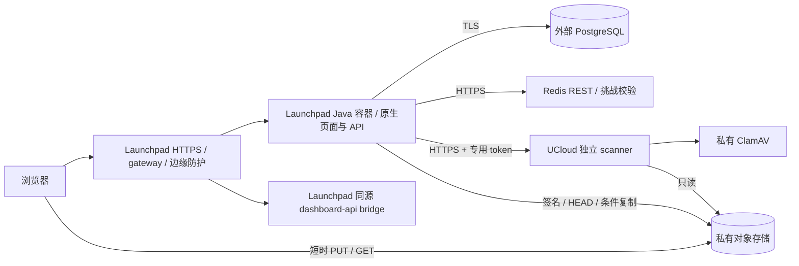

# Java 版本 Launchpad 部署环境与配置合同

> 2026-11-11 · Java代码、本地构建及平台计划已实现，尚未平台构建/发布。用户确认应用部署环境为 **Launchpad**；证据范围见 [实施状态](JAVA-IMPLEMENTATION-STATUS.md)。
> 配套 [迁移 PRD](JAVA-MIGRATION-PRD.md)、[API](API-DESIGN.md)、[数据库访问](DATABASE-ACCESS.md)；核对记录见 [文档审计](DOCUMENTATION-AUDIT.md)。
> 已执行本地构建、隔离PostgreSQL和浏览器测试，并修改本地代码/部署文件；未发布、未改变平台运行配置或Secrets、未操作生产数据库或UCloud。

## 1. 环境边界与当前证据

| 层 | 目标环境 | 责任与验证边界 |
|---|---|---|
| 应用计算 | Launchpad 项目 `1793096891306`（sider）中的 Java Docker 容器 | Java API、原生静态页面、本站会话、业务权限与后台调度 |
| 入口与域名 | Launchpad HTTPS 域名、受控 gateway/反向代理及边缘防护 | 同源 `/dashboard-api/` bridge、origin 注册与保留 callback；新容器仍须真实浏览器验证 |
| 应用变量/Secrets | 同一 Launchpad 项目的运行时配置 | 部署文件只保存名称/引用，不写真实值；不将生产 Secrets 注入镜像构建层 |
| 数据 | 现有外部 PostgreSQL、私有 S3 兼容对象存储、共享 Redis REST | 不因换 Java 把这些服务迁至应用容器或 UCloud |
| 扫描 | UCloud 上的独立 scanner/ClamAV | Launchpad 经真实 HTTPS 扫描端点调用；应用不部署到此主机 |
| 构建/发布 | `backend/Dockerfile` 与根 `.launchpad/deploy.json` 的Java计划 | 本地文件已就位，尚未执行Docker或平台构建；旧Node计划另存infra/legacy |

本次只读状态快照：项目 sider，kind=docker，publicUrl=`https://siderlearn.com`，平台报告 online，HTTP 探测返回 307，记录的映射端口为 58131。这只说明既有发布当时可响应，不是 Java 容器、业务依赖或真实登录验收，也不是目标容器应绑定的端口。

本次读取 Launchpad 的 `deploy-config`、`docker`、`sign-in-with-launchpad` 手册：平台支持 `runtime=dockerfile`、显式 port/healthPath、构建/运行环境引用与资源请求。Docker 支持不等于 Java 镜像已完成验证；项目的实际 CPU/内存/进程/构建限额和容器出站能力须另取证。**UCloud 的 2 核/4 GB/30 Mbps 不能用作 Launchpad 应用规格。**

## 2. 运行与构建基线

| 组件 | 设计基线 | 实施要求 |
|---|---|---|
| Java | Java 21 LTS | 构建与运行主版本一致，固定发行商、安全补丁及镜像 digest |
| 框架 | Spring Boot 4.1.2、Spring MVC、嵌入式 Servlet 容器 | 本地编译、verify及JAR浏览器检查已通过；平台运行仍待验收 |
| 构建工具 | Maven 3.9；Docker构建阶段固定3.9.11，无仓库Wrapper | 已提供多阶段Dockerfile；运行镜像只带JRE、JAR及必要CA，不带生产配置/编译缓存 |
| 前端 | 原生 HTML、CSS、JavaScript ES Modules | 随 JAR 提供，与 API 共用 origin；无需 React/Vue/Next.js 生产进程 |
| 容器运行 | Launchpad 受管理的 Docker 运行环境，非 root 用户 | 绑定 0.0.0.0，监听端口与平台计划一致，不依赖容器里的 systemd |
| 后台任务 | 同 JVM 专用调度执行器，共用一个 Hikari 池 | 可恢复队列在 PostgreSQL；支持平台重启/替换/多实例，不用内存任务代替持久化 |

运行时兼容参考：[Spring Boot 系统要求](https://docs.spring.io/spring-boot/system-requirements.html)。本分支已有pom、Java Dockerfile与本地生成的JAR；完整Java verify60项及后续上传定向12项通过，合计61个不同Java用例，另有Node15项和Java+Edge29项通过。镜像可拉取性、平台构建预算、容器启动时间和实际资源仍未验证；本机无Docker工具，不把JAR测试冒充镜像测试。

首版发布路径是 **源码快照 → Launchpad Dockerfile 构建 → 平台运行 Java 容器 → 平台入口路由**。不上传 JAR 到 UCloud 版本目录，不为 Java 编写 UCloud systemd unit，不改 `/root/.openclaw`。

## 3. 分层环境与连接

| 环境 | 应用与身份 | 数据隔离 |
|---|---|---|
| local | Java21、本地8080，同源开发桥接，平台许可的devOrigin；OIDC dev=1 | 本机或隔离测试数据库/存储/限流，绝不回退生产 |
| 自动测试 | 无生产Secrets，显式隔离集成环境 | 合成数据；mock不能代替真实SDK/存储验证 |
| staging | Launchpad独立预览/测试发布及注册HTTPS origin，OIDC dev=0 | 隔离DB、bucket/前缀与限流空间；不另建重复正式项目 |
| production | 现有Launchpad项目与正式HTTPS域名，OIDC dev=0 | 原外部服务；应用、扫描、迁移分别持最小权限凭据 |

Spring 不会自动读取 `.env.local`；由 Launchpad 环境引用显式注入。Java profiles 为 local/staging/production，后两者都执行生产安全校验。平台Docker手册说明私网/metadata访问默认受限；不能假设容器能访问 UCloud 的10.7.133.171、宿主127.0.0.1或任意VPC服务。数据库、扫描器和其他依赖应使用已验证可访问的TLS端点。

## 4. 网络与路由

- 目标内部监听为 `SERVER_ADDRESS=0.0.0.0`、`SERVER_PORT=8080`，平台部署计划 port 同为8080；58131是当前状态返回的映射端口，不硬编码进Java。若实际计划注入其他PORT，必须显式映射到SERVER_PORT并核对resolved plan，Spring不会自动将PORT当server.port。
- 平台负责域名、HTTPS入口、容器路由及证书；不要求用户在UCloud为Java添加Nginx/8080/443规则。容器8080由平台gateway接入，不自行开放无鉴权的宿主入口。
- `/api/**` 返回JSON并执行会话/权限/同源检查；JSON正文64KiB上限、413格式和超时在Java及平台入口联合验证。不得将API错误改写为index.html。
- `/dashboard-api/**` 由平台同源bridge承接，应用不拦截为静态路由，也不向此路径注入本站会话头。保持平台受信代理给出的origin上下文。
- `/__lp_auth/callback` 服从平台SDK的保留callback合同；是否由平台响应或转交应用适配需实测。若沿用应用白名单参数回传，只允许SDK继续处理，不另建Java code交换状态机。
- `/api/internal/**` 始终校验独立CRON_SECRET。优先同JVM直接调度；HTTP运维调用使用平台允许的服务/管理通道，不依赖自管Nginx location deny。平台若可配置入口限制，再叠加控制，不能声称此限制已生效。
- 当前静态资源尚无内容哈希，安全过滤器对全部响应采用保守no-store；不把文件名固定的JS/CSS标为immutable。内容哈希与选择性静态缓存是后续优化，须联合Service Worker更新/退出与会话边界验证后启用。
- 页面切换在当前标签页内复用白名单 JSON 元数据（30 秒，公开配置 60 秒，最多 24 项），不落入 HTTP/Service Worker 或浏览器持久化存储。写操作、显式刷新、退出及未授权响应清除缓存；下载和文件正文不缓存。详见 [页面预加载](NAVIGATION-PREFETCH.md)。
- 只接受平台明确覆写的真实IP头；核对 `TRUSTED_CLIENT_IP_HEADER` 与平台实际代理合同。伪造X-Forwarded-For/Forwarded不能改变限流身份。

外部扫描连接只能使用真实可访问的HTTPS扫描端点。UCloud scanner映射在宿主127.0.0.1:8081时，Launchpad容器不能直接调用它；由UCloud受控TLS代理转发，例如现有模板的 `/internal/malware-scan` →本机 `/scan`，配置URL必须与实际映射一致。ClamAV3310不对公网开放。

## 5. 资源、生命周期与存储

Launchpad实际资源以项目tier及resolved plan为准。手册说明resources只能下调tier额度，写入更大memory不意味着取得更多资源。记录CPU、内存、进程数、磁盘、构建预算及重启/空闲回收行为；不能套用UCloud机器规格。

Dockerfile默认以 `InitialRAMPercentage=10`、`MaxRAMPercentage=60` 作为容器内存感知起点，并指定可写临时目录；运行时JAVA_TOOL_OPTIONS可覆盖。变量示例中的 `-Xms128m -Xmx512m` 只是总进程预算至少1GiB时的测试值，不是已知平台配额。堆外、类元数据、线程栈、直接缓冲也占内存；实际额度确认及压测前不直接发布。API与worker共享默认最多5个数据库连接；旧新发布并行、多实例和迁移连接都计入总预算。

持久资源元数据/会话/任务只存PostgreSQL，文件只存私有对象存储；容器本地仅临时数据与可轮转日志，不把可写目录持久性当作正确性依赖。正常终止时停止领取任务，在平台grace period内有界结束，未完成任务等待300秒租约回收；禁止在请求结束后fire-and-forget执行发布。

UCloud仍只承担扫描及其已有OpenClaw。根据AGENTS.md保留 `/root/.openclaw`，不覆盖、不停止、不移目录。其2核/4GB/80GB/30Mbps规格仅用于扫描侧预算；ClamAV签名加载/更新、scanner全文件chunks+Buffer.concat以及OpenClaw峰值仍须测量。默认50MiB上限不能单独提高，须联动scanner/ClamAV大小限制与超时。应用JVM不计入此主机预算。[ClamAV容量参考](https://docs.clamav.net/Introduction.html#recommended-system-requirements)。

## 6. Launchpad变量与Secrets

应用模板：[Java生产变量](examples/java-production.env.example)；扫描模板：[scanner变量](examples/scanner-production.env.example)。模板只供核对，正式值在各自环境注入；不将模板直接复制为已验证的部署计划。

只读平台名称/作用域核对发现35项运行时引用中有9名尚未登记；完整名单见 [实施状态](JAVA-IMPLEMENTATION-STATUS.md#3-平台运行时变量登记缺口)。旧NEXT_PUBLIC_BOT_SITE_KEY存在不能替代计划明确引用的BOT_SITE_KEY主名。已有26名也未验证真实值、权限或生产TLS；本次没有创建或修改平台变量。

| 归属 | 配置 | 规则 |
|---|---|---|
| 应用运行器 | SPRING_PROFILES_ACTIVE、SERVER_ADDRESS、SERVER_PORT | production；0.0.0.0；与平台port一致的8080设计值 |
| 应用配置 | APP_BASE_URL、JAVA_TOOL_OPTIONS | 注册HTTPS origin；JVM参数先满足真实配额，不含secret |
| 会话 | SESSION_TRANSPORT、SESSION_TOKEN_PEPPER、SESSION_TTL_SECONDS | cookie或显式header-compat；独立pepper；最大3600秒 |
| 分页 | CURSOR_SIGNING_KEY | 独立随机密钥至少32字节，编码由实现明确 |
| 数据库 | DATABASE_URL、DATABASE_MAX_CONNECTIONS | 运行低权限账户，生产verify-full；默认池上限5受总预算约束 |
| 身份 | SHSID_ADMIN_SUBS、SHSID_LAUNCHPAD_OIDC_DEV | sub白名单不公开；生产dev=0，不启用旧发现页 |
| 存储 | S3_ENDPOINT/REGION/BUCKET/FORCE_PATH_STYLE、S3_ACCESS_KEY_ID/SECRET_ACCESS_KEY | 显式HTTPS/私有bucket；对象读/写/删除、pending与active的受限ListBucket；HEAD依据对象读权限，copy需源读/目标写，无bucket管理权限 |
| 文件 | UPLOAD_MAX_BYTES | 默认52428800，最大配置524288000；扩大前联合验收，/api/config只公开上限 |
| 旧上传兼容 | LEGACY_UPLOAD_ENABLED | 默认false；旧中转PUT返回410，仅明确评估旧客户端后开启，新前端不调用 |
| 限流 | RATE_LIMIT_URL/TOKEN、RATE_LIMIT_MULTIPLIER、OAUTH_START_IP_LIMIT、TRUSTED_CLIENT_IP_HEADER | 共享Redis REST，默认乘数1、会话交换300/600秒起点；受信头按平台核实 |
| 遗留命名 | OAUTH_CALLBACK_IP_LIMIT | 保留600配置兼容旧运维；不因此另建Java callback风控/PKCE状态机 |
| 挑战 | BOT_SITE_KEY、BOT_VERIFY_URL/SECRET | 只有site key由/api/config公开；其余不出服务器 |
| 扫描 | MALWARE_SCAN_URL/TOKEN、MALWARE_SCAN_TIMEOUT_MS | 真实HTTPS+专用token；默认30000ms；成对disabled仅登录联调，禁止正式上传 |
| 任务 | UPLOAD_WORKER_ENABLED、CRON_SECRET、RESOURCE_DELETE_RETENTION_DAYS | 至少一个受监控worker=true；cron独立随机密钥≥32字节；默认保留7天 |

所有secret通过Launchpad运行时secret引用，不进入build环境/JAR/镜像层/日志。当前平台手册说明releaseCommand继承runtime环境，因此首版保留独立受控迁移作业，仅在作业阶段注入高权限DATABASE_URL_UNPOOLED，不把DDL凭据长期下发到应用。若未来使用平台releaseCommand，先验证可以隔离迁移身份再启用，不能为了省步骤将高权限迁移连接交给常驻Java进程。

`BOT_SITE_KEY` 为新运行时主名，旧NEXT_PUBLIC_BOT_SITE_KEY只作过渡别名；二者同时设置且不同启动失败，不再构建时内联。SESSION_TRANSPORT、UPLOAD_WORKER_ENABLED及LEGACY_UPLOAD_ENABLED已由Java显式读取/校验。NODE_ENV/HOSTNAME不替代Spring配置，application.properties提供PORT到server.port的后备映射，平台计划仍固定8080并优先显式SERVER_PORT。旧SESSION_SECRET/SHSID_LAUNCHPAD_ORG_DISCOVERY_EMAIL不作为Java必需配置。扫描器只有只读S3身份及scanner/ClamAV设置，不获得数据库、pepper、管理员列表或cron secret。

目标优先cookie，但平台既有Cookie丢失记录仍需回归；不能因换成Docker/Java就声称Set-Cookie已保留。明确选择header-compat时沿用短期本站token、IndexedDB/同源Service Worker与跨域保护，不自动降级。

## 7. 发布计划与迁移

根 `.launchpad/deploy.json` 已改为Java计划：root=backend、runtime=dockerfile、port=8080、healthPath=/api/health、运行时引用、ignore规则与rollbackPolicy；采用 `backend/Dockerfile`。计划不含releaseCommand、Node安装/启动命令或启动DDL。文件已修改不代表平台resolved plan或Java发布已验证。

旧平台计划保存为 `infra/legacy/launchpad-next.deploy.json`，根Node Dockerfile/Compose与旧源码仍作为回切参考。`node scripts/package-java-launchpad.mjs <release-tag>` 只生成本地Java源码快照及计划，排除旧Node入口、env和target输出，不执行发布。使用该快照避免旧Compose检测器选中Node栈；发布前仍需核对平台resolved plan，不创建第二个正式项目。

Java启动不迁移、不自动建表；首版复用七表和既有Drizzle历史。迁移工具独立注入direct URL且最大连接1；现有Drizzle CLI默认可读.env，但不自动读取Next.js的.env.local，不能依赖回退应用池化URL。没有必需DDL时不执行空洞的“迁移初始化”，不重写journal、不删除旧OAuth表。

后续发布顺序：确认本地测试证据→平台Java构建/启动与配额检查→既有项目origin/bridge/SDK/Cookie实测→外部TLS与权限/出站检查→worker/清理/真实合成文件全链路→平台健康/回滚计划核对→具体发布。用户已要求实施代码；发布与生产切换尚未执行，需提交具体版本/配置引用/回切方案后取得最终确认。

回切保留上一份已验收平台发布及Secrets版本；先协调停止新worker，避免未验证的新旧fencing混用。数据库迁移不会被平台应用回滚自动撤销，队列和对象不得清空；旧版无法解释新状态/任务时须先对账再切。平台300秒观察窗口是配置候选，不代表所有业务验收在5分钟内完成。

## 8. 任务、健康与验收

- 同JVMworker空闲每5秒检查，按持久队列与300秒租约运行，全局有效并发1，三次尝试、30/60秒退避；平台休眠/终止会暂停处理，必须监控心跳、最老任务年龄和副本数量。若tier会休眠，启用上传前确认常驻策略，不假定后台线程永远存活。
- cleanup每15分钟，每轮最多200资源与200结束任务；短事务终态声明→外部对象删除→CAS确认。保护queued/processing输入。
- 孤儿对账每轮另外枚举pending/与active/各一页最多200对象，用continuation token跨轮推进；仅处理超过15分钟且无resources/job引用的应用布局key。单项失败留待该页重试，重启从头开始不影响正确性；不承诺一次清理清空存储。
- pending/两天自动Lifecycle模板不能原样应用到活跃快照；需要经过验证的标签/前缀或保留策略，未知数据库引用不删。容器重建不能丢失任务恢复依据。
- /api/health只表示进程存活。平台可将它用作启动探测，但/api/internal/ready仅覆盖DB/Redis/存储；scanner、真实SDK、挑战、worker和备份恢复需要独立证据。
- 部署验收：平台Java容器正确plan、配额/启动/退出、域名/bridge/SDK/Cookie、受信IP、TLS出站、50MiB/CORS/签名、扫描与清理竞态、限流/挑战、连接预算、Secrets隔离、恢复与回切。UCloud仅检查扫描及OpenClaw共存，不作为应用部署目标。

## 9. 当前配置适用范围

| 文件 | 处理 |
|---|---|
| `.launchpad/deploy.json`、backend/Dockerfile | 已提供Java计划/构建文件，平台resolved plan和镜像验证仍待执行 |
| `infra/legacy/launchpad-next.deploy.json` | 原Node平台计划备份，仅供回切评审 |
| 根Dockerfile、compose.yaml | 旧Node文件；未改为Java，不直接用于目标发布 |
| `.github/workflows/java.yml`、scripts/package-java-launchpad.mjs | 新Java/隔离PG/原生前端CI与本地源码快照工具；不代表远端CI或发布已运行 |
| `.github/workflows/ci.yml` | 原TypeScript CI保留，不能代替Java检查 |
| `.env.example`、`.env.production.example` | 旧Node模板；Java按独立示例配置平台Variables/Secrets |
| `infra/nginx/siderlearn.conf` | 旧自托管应用/扫描代理模板，仅扫描侧按实际需要评估；不是Launchpad入口配置 |
| `infra/systemd/certbot-renew.*` | UCloud既有扫描TLS/自托管模板，不是Java应用的启动或证书续期要求 |
| `services/malware-scanner/*` | UCloud独立扫描服务，HTTP合同可保留，镜像/内存/凭据单独验证 |

平台依据：[部署配置手册](https://launchpad.standardcas.org/manual/deploy-config)、[Docker隔离手册](https://launchpad.standardcas.org/manual/docker)、[登录手册](https://launchpad.standardcas.org/manual/sign-in-with-launchpad)，设计阶段通过平台只读工具读取。项目online快照不是Java发布验收。本次已修改仓库部署计划及代码，但未把它应用到平台；文档/示例不含真实Secrets，平台变量、生产数据库和UCloud服务均未修改。
